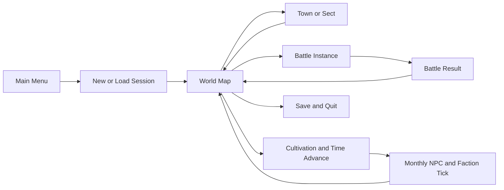

# Kiến trúc kỹ thuật — Godot 4.7.x GDScript

## 1. Vì sao chọn Godot
- 2D native, scenes/nodes, CharacterBody2D, TileMapLayer, camera, animation, VFX và signal; phát hành Windows `.exe` không cần Electron.
- Open source, bản stable, không yêu cầu phí runtime; GDScript đủ để Antigravity tạo logic theo mô đun.
- Vẫn có thể dùng TypeScript/Phaser/Electron, nhưng với game bản đồ + combat + UI RPG 2D, **khuyến nghị Godot** cho một dự án mới.
- Xác minh version Godot stable khi bắt đầu và dùng cùng branch trong cả dự án.

## 2. Cấu trúc project sau khi Antigravity scaffold
```
dao-tan-van-kiep/
  project.godot
  export_presets.cfg
  AGENTS.md
  README.md
  docs/
    IMPLEMENTATION_STATUS.md
    KNOWN_ISSUES.md
    CHANGELOG.md
    TEST_REPORTS/
  assets/
    fonts/  audio/  sprites/  tilesets/  vfx/  portraits/
  data/
    regions/  npcs/  factions/  items/  skills/  enemies/
    breakthroughs/  dialogue/  quests/  events/  balance.json
  scenes/
    bootstrap/  menu/  world/  towns/  combat/  ui/  common/
  scripts/
    core/         # clock, event_bus, id_registry, rng, state_machine
    domain/       # player, npc, sect, cultivation, skill, inventory
    systems/      # map_gen, npc_sim, combat, quest, loot, economy
    persistence/  # save_service, migration, validation
    presentation/ # presenters/UI adapters, audio/visual cues
  tests/
    unit/  simulation/  integration/  manual/
  tools/
    content_validator/  data_migration/
```

## 3. Runtime state
- Autoloads nhỏ: `GameSession`, `GameClock`, `EventBus`, `SaveService`, `ContentRegistry`, `RNGService`.
- `WorldState` thuần dữ liệu: seed, clock, entities, region states, quest/event flags, market, faction states.
- `SceneCoordinator` chuyển World <-> Town <-> Battle; không tự tạo lại player data khi load scene.
- ID stable cho NPC, quest, item template, generated instance; không dùng display name làm ID.
- Data validation trước load, báo rõ record lỗi, fail safe về menu nếu save bị hỏng.

## 4. Engine flow


## 5. World generation & map architecture
- Seeded world grid; bắt đầu bằng **hand-authored hub map** (1 trấn + Vân Lĩnh rìa) để đảm bảo UX trước procedural.
- Sau Phase 2: procedural POI/biomes theo deterministic seed + setpieces authored.
- `RegionData` gồm ID, bounds, unlock_req, tile_theme, event_spawn_table, NPC spawn home.
- POI quest-critical được bảo vệ khỏi generator; không mọc giữa núi không có đường.
- Combat arena tách biệt scene, có arena ID / encounter_id / enemy group; return location stable.

## 6. Save format
- Save `user://saves/slot_01.json` + `slot_01.meta.json` và backup `slot_01.bak.json`.
- `schema_version` integer, `game_version`, `world_seed`, `clock`, `player`, `npcs`, `factions`, `regions`, `quests`, `events`, `rng_counters`.
- Khi save ghi ra temporary rồi rename/replace an toàn theo API nền tảng; khôi phục từ backup nếu failed parse. Không serialize node references hoặc resources trực tiếp.
- Migration script từ N sang N+1, unit test roundtrip.
- Autosave khi nghỉ trọ/chuyển vùng/đột phá, không save giữa transaction chiến đấu.

## 7. Data-driven design
- JSON cho danh sách game content, typed script wrappers + validator. Không để tài nguyên có raw logic tùy tiện.
- `ContentRegistry` load tất cả định nghĩa theo thứ tự và kiểm tra referential integrity (`skill_id`, `quest_id`, `npc_id`).
- Dễ mở rộng là thêm data entry và asset (không cần sửa combat core).
- Chú ý `data_examples/` là mẫu gợi ý, Antigravity cần tạo schema thật và validator tương ứng.

## 8. Performance
- FPS target 60 ở 1080p trên PC tầm trung, scalability 30–120 FPS nhưng gameplay physics tick cố định.
- Không có process() nặng trong mỗi NPC; simulate batch theo tháng, giới hạn pathfinding cho NPC gần.
- Object pooling cho projectile/VFX và culling ngoài camera.
- Profile: thời gian chuyển tháng, FPS arena 20 enemy, load save 50 NPC, memory sau 3 giờ idle.

## 9. Testing commands (điều chỉnh đường dẫn executable)
```
godot --version
godot --headless --path . --editor --quit
godot --headless --path . --quit-after 120
godot --headless --path . --export-release "Windows Desktop" build/DaoTanVanKiep.exe
```
- Chỉ chạy export nếu đã cài export templates và thiết lập preset `Windows Desktop`.
- Kết quả headless không thay thế playtest GUI combat.
- Test deterministic world simulation + save/load bằng scene/script runner riêng.

## 10. Audit deliverables
- `docs/IMPLEMENTATION_STATUS.md`: DONE / PARTIAL / NOT STARTED có bằng chứng file và cảnh chơi.
- `docs/KNOWN_ISSUES.md`: severity, repro steps, planned fix.
- `docs/CHANGELOG.md`: thay đổi theo phase.
- `docs/TEST_REPORTS/PHASE_XX.md`: commands, output summary, UI screenshots path, FPS if measured.
