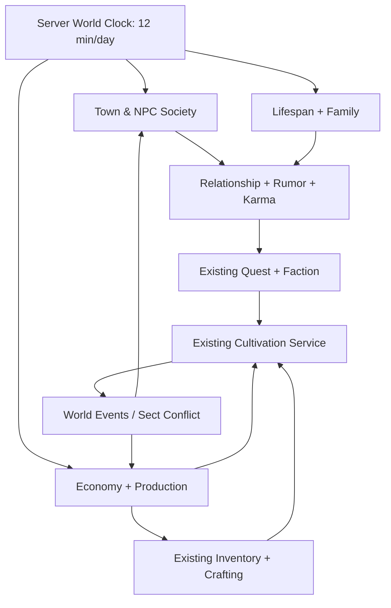

# ĐẠO TÀN: VẠN KIẾP — BẢN MỞ RỘNG CO-OP: XÃ HỘI, KINH TẾ NPC & GIA TỘC / TRUYỀN THỪA

> **Tài liệu triển khai trực tiếp cho Antigravity — V1.0, 04/11/2026**  
> **Trạng thái:** nghiên cứu nguồn công khai + đề xuất game design/technical spec; **chưa phải tính năng đã code hoặc test**.  
> **Chế độ đích:** Godot 4.7.x / GDScript / Windows / co-op 2–4 người (quy mô khởi đầu được đề xuất; có thể điều chỉnh).  
> **Quy tắc thời gian bắt buộc do chủ dự án lựa chọn:** **1 ngày trong game = 12 phút ngoài đời** khi tốc độ x1.  
> **Cách dùng:** đưa file này vào `docs/10_COOP_SOCIAL_ECONOMY_DYNASTY.md` trong **workspace game hiện tại**, rồi thực thi **PROMPT TRIỂN KHAI** ở phần 20. KHÔNG tạo lại game, KHÔNG thay toàn bộ GDD hoặc xóa hệ thống Tiên Nghịch/Tale of Immortal đã xây.

---

## 0. MỆNH LỆNH QUAN TRỌNG CHO ANTIGRAVITY

1. Đây là **bản mở rộng có tính cộng dồn**: giữ thế giới tiên hiệp nguyên bản, cảnh giới/tu luyện/đạo tâm/nhân quả và combat/bản đồ/công pháp đang có. Các game tham chiếu **chỉ cung cấp nguyên lý cơ chế**; không sao chép IP, nội dung, art, UI, mã nguồn hay dữ liệu riêng của họ.
2. **ĐỌC MÃ NGUỒN TRƯỚC KHI SỬA.** Dò phiên bản repo thực tế, nhánh Git, `AGENTS.md`, cấu trúc autoload, `GameClock`, `NPC`, `WorldState`, `Economy`, `SaveService`, network (nếu đã có) và tests. Ghi lại `docs/COOP_EXPANSION_AUDIT.md`. File blueprint cũ từng mô tả **offline single-player + NPC batch theo tháng**; đó là **tư liệu lịch sử, không bảo đảm repo hiện tại vẫn như vậy**.
3. Cập nhật quyết định thiết kế có chủ đích: **co-op là mục tiêu mới** và **12 phút/ngày là đồng hồ chung**. Không tạo các clock riêng chạy độc lập ở từng client.
4. Áp dụng bằng **migration, adapter, feature flags**; giữ save cũ, không ghi đè `project.godot`, scene, data hoặc hệ thống đã có mà không lập diff/backup. Lập commit/branch trước; chỉ nâng schema khi có migration + test.
5. Cấu trúc ba trụ cột: **(A) phố phường / xã hội sống**, **(B) kinh tế NPC / cung–cầu**, **(C) vòng đời / quan hệ / gia tộc / truyền thừa**. Chúng phải tác động ngược lại tu luyện và nhân quả; **không được biến game thành city-builder bắt buộc**.
6. Làm **vertical slice nhỏ chơi được thật**: 1 trấn, 20–30 NPC, 4–6 nghề, 5 loại cửa hàng, 1 chuỗi cung ứng, 1 sự kiện quan hệ, 2 client co-op. Không triển khai toàn bộ mô phỏng khổng lồ cùng lúc.
7. Nguồn nghiên cứu được phân loại **[XÁC MINH] / [NHÀ PHÁT TRIỂN DỰ KIẾN] / [THIẾT KẾ ĐỀ XUẤT]**. Những con số và thuật toán trong phần thiết kế là **đề xuất cho Đạo Tàn**, **không** được trình bày như tính năng có sẵn của các game tham chiếu.

---

## 1. BA GAME THAM CHIẾU — NHỮNG GÌ THỰC SỰ BIẾT ĐƯỢC

### 1.1. The Bustling World / 烽火与炊烟 — nền tảng **xã hội và thành thị**

**[XÁC MINH: lời giới thiệu chính thức trên Steam/nhà phát hành; phần lớn là thiết kế được quảng bá, không đồng nghĩa đã được chơi kiểm chứng]**

- Cư dân có đặc điểm tính cách và ràng buộc gia đình, dự kiến tự chọn ở nhà, đi làm, vui chơi, chuyển thành, xây nhà, vận hành cửa hàng, báo thù, tránh chiến tranh.
- Người chơi dự kiến có thể buôn bán, tuyển nhân viên, phát triển chuỗi cửa hàng, khuyến mãi/đối đầu thương nghiệp, sản xuất và quản lý dòng hàng.
- Hoạt động thủ công/nông nghiệp/chăn nuôi, chuỗi sản xuất và quản lý thành phố; chính sách thành phố, ngoại giao và liên minh/thù địch các phe.
- Nhà phát triển diễn giải dân cư sau khi người chơi làm thành chủ có thể chuyển đến, lập hộ gia đình và phát triển sản nghiệp; sự kiện trộm cắp, hỏa hoạn, tội phạm hoặc quản trị tồi làm thay đổi sự hài lòng/di cư.
- Quan hệ, động cơ, thế lực và pháp luật làm các NPC phản ứng với hành động của người chơi.

**Giới hạn cần phân biệt (rất quan trọng):** FAQ chính thức trên Steam nói nhân vật **không có giới hạn tuổi thọ kiểu tu tiên**, **không có hệ thống kế thừa nhân vật khi chết**, hệ nhu cầu được nêu có **đói nhưng không có khát**. Về multiplayer, nội dung cũ từng nói hỗ trợ co-op, nhưng **FAQ mới hơn nói chỉ đang cân nhắc P2P sau phát hành, chưa cam kết ra mắt**. Do đó tuyệt đối **không** lấy The Bustling World làm bằng chứng về multiplayer đã hoạt động hoặc mô phỏng vòng đời trăm năm. Các khía cạnh đó thuộc thiết kế nguyên bản của Đạo Tàn. [R1] [R2]

**Lấy cảm hứng cho Đạo Tàn (đề xuất):** quy hoạch phố bằng các *POI có chức năng* (chợ, khách điếm, tiệm đan, phường rèn, nhà dân, thương hội, nha môn), hộ gia đình, nghề nghiệp, lịch NPC, di cư, trị an, danh tiếng, đường cung ứng và thị trường địa phương.

### 1.2. The Matchless Kungfu / 绝世好武功 — nền tảng **hành vi tiêu dùng và giao dịch NPC**

**[XÁC MINH: changelog chính thức Steam, 07–09/2025]**

- Bản 1.3 (29/09/2025) ghi rõ NPC phát sinh **nhu cầu tiêu dùng mỗi ngày**; nếu đủ điều kiện và ở trong khoảng phù hợp, NPC đi đến cơ sở do người chơi vận hành để mua dịch vụ/hàng. Ở thời điểm changelog đó các nhu cầu được nêu cụ thể là **ăn, uống và ngâm suối nước nóng**; không tự suy ra đã có đủ nhu cầu y tế, học tập, trang bị... [R3]
- Có chức năng giao dịch nguyên liệu qua một số nghề/NPC theo **chu kỳ ba ngày**, giới hạn số lượng và giá có thể biến động; điều chỉnh giao dịch qua hội thoại và kỳ reset 3 ngày. Nghề được nêu: quản mã, quản suối nước nóng, thợ thủ công, nhạc quán, tửu quán, thợ rèn, thầy thuốc, thợ dệt. **Lưu ý:** cách diễn đạt bản tiếng Anh dịch từ tiếng Trung về chiều mua–bán có thể không đồng nhất; chỉ coi lịch giao dịch/hạn mức/giá là đã xác nhận. [R3]
- NPC được bổ sung nguồn lực/tiền theo chu kỳ 3 ngày dựa trên thân phận và sức mạnh; thợ mỏ, tiều phu được nêu là ví dụ tạo tài nguyên nghề; có cơ chế giảm hiệu suất khi vượt một số ngưỡng sở hữu. [R4]
- Changelog 08/2025: faction trong tông môn, tài nguyên doanh thu phe, quan hệ phe độc lập với quan hệ cá nhân, tính cách/quyền lực góp phần gây xung đột; quan hệ thân thiết có thể phát triển theo thời gian. [R5]

**Lấy cảm hứng cho Đạo Tàn (đề xuất):** ví NPC, ngân sách nhu cầu, quầy hàng với tồn kho thật, giới hạn nguồn cung, sổ cái giao dịch, nghề sinh sản lượng theo chu kỳ, chiến lược giá/chi phí, cửa hàng có nhân công, mở/đóng theo giờ; **mở rộng nguyên bản** từ ba nhu cầu của game gốc sang nhu cầu dược phẩm, pháp bảo, thuê trọ... phù hợp tu chân giới.

### 1.3. The Scroll of Taiwu: Beyond the Dome / 太吾绘卷 — nền tảng **quan hệ, đời người và truyền thừa**

**[XÁC MINH: Steam chính thức và thông cáo V1.0 (17/06/2026)]**

- Thế giới tạo sinh với NPC/người chơi có quan hệ và trải nghiệm riêng. NPC **già đi, mắc bệnh, chết**, hình thành quan hệ; người chơi có thể kết hôn, sinh con, học võ và truyền kỹ nghệ cho người kế thừa. [R6]
- Có xây dựng, thu thập, mở rộng, quản lý làng, chế tạo và bảo trì; tông phái và kỹ nghệ tác động đến quá trình chơi. [R6]
- V1.0 phát hành 17/06/2026 với những cập nhật AI NPC và nội dung, theo tài liệu công bố của nhà phát triển; cần xem hệ này là **tham chiếu tư duy thiết kế** chứ không phải bản đặc tả nội bộ công khai. [R7] [R8]

**Lấy cảm hứng cho Đạo Tàn (đề xuất):** đồ thị quan hệ có cạnh thưa, động cơ/ghi nhớ, huyết thống, hôn phối, sư đồ, tài sản và kế thừa, tuổi thọ theo cảnh giới, hậu duệ có kí ức gia tộc, NPC chết vẫn để lại di sản/biến cố/tên tuổi.

### 1.4. So sánh để quyết định tính năng

| Trụ cột | Cơ chế tham khảo đã có tài liệu | Bổ sung nguyên bản vào Đạo Tàn | Không đưa vào bản đầu |
|---|---|---|---|
| The Bustling World | Nếp sống, ngành nghề, cửa hiệu, chính sách, quan hệ cư dân *(nhiều phần là roadmap)* | Bản đồ trấn có chu kỳ sinh hoạt, khu nghề, nhà dân, di cư có nguyên nhân | Chiến tranh toàn lục địa, thiết kế hàng nghìn mảnh xây dựng |
| The Matchless Kungfu | Nhu cầu NPC mỗi ngày; hạn mức giao dịch và thu nhập mỗi 3 ngày; phe phái | Thị trường có hàng tồn, chuỗi nguyên liệu→thành phẩm→khách mua; giá biến động kiểm soát | Mô phỏng đấu giá phức tạp, tài chính toàn cầu |
| The Scroll of Taiwu | NPC sống–già–bệnh–chết, kết hôn/con cái/truyền thừa, làng | Quan hệ có hậu quả, tuổi thọ tu sĩ, thư tín/di chúc, kế nhiệm | Tạo hàng nghìn quan hệ thường trú và cây gia phả vô hạn |

---

## 2. TRIẾT LÝ KẾT HỢP — VẪN LÀ GAME TIÊN HIỆP

1. **Tu luyện là trục chính**. Mua bán kiếm linh thạch **không** thay thế linh căn, căn cơ, ngộ đạo, tâm ma, thiên kiếp hoặc điều kiện đột phá.
2. **Xã hội tạo cơ duyên lẫn ràng buộc**: thương nhân tạo tin tức bí cảnh; cửa hiệu là nguồn linh dược; bằng hữu giúp tìm người luyện khí; lời thề/giao dịch trái đạo tâm tạo nhân quả.
3. **Thời gian có trọng lượng**: người phàm có thọ mạng ngắn, tu sĩ cấp cao sống lâu, nhưng thế giới vẫn thay đổi trong những năm tu hành. Không ngẫu nhiên giết NPC nhiệm vụ khiến game softlock.
4. **Tự do nhưng có giá phải trả**: mở tiệm tăng tài nguyên nhưng mất thời gian/cần quản lý; gia tộc đem lại trợ lực nhưng tạo nghĩa vụ; tông môn cung cấp linh mạch nhưng có luật lệ.
5. **Co-op không ép chơi chung nghề**: Player A tu luyện/đánh quái, B làm thương hội, C luyện đan, D xây quan hệ. Cùng sử dụng **một thế giới, một đồng hồ, một thị trường**, quyền sở hữu minh bạch.
6. **Không copy Tiên Nghịch/other IP**: thiết kế lore, tên địa danh, nhân vật và tài sản hình ảnh bản quyền riêng. Tôn trọng hệ tu luyện/công pháp đã có trong repo.

---

## 3. ĐẶC TẢ THỜI GIAN CO-OP — 1 NGÀY = 12 PHÚT THỰC

### 3.1. Công thức và calendar

```
REAL_SECONDS_PER_GAME_DAY = 720
GAME_MINUTES_PER_DAY     = 1440
REAL_SECONDS_PER_GAME_MINUTE = 0.5
GAME_MINUTES_PER_REAL_SECOND = 2

world_total_game_minutes = floor(authoritative_unpaused_elapsed_seconds * 2) + saved_offset
# ĐỒNG HỒ authoritative của host/server; không lấy đồng hồ thiết bị client.
```

- 1 giờ game = **30 giây thực**; 08:00→20:00 = **6 phút thực**.
- 1 ngày game = **12 phút thực**; 3 ngày game = **36 phút thực**.
- **Quy ước đề xuất**: 30 ngày/tháng, 12 tháng/năm, 360 ngày/năm. 1 tháng = **6 giờ thực**; 1 năm = **72 giờ thực**; 100 năm = **7.200 giờ = 300 ngày thực liên tục**.
- Sử dụng `world_day_index: int64`, `game_minute_of_day: int(0..1439)` làm nguồn sự thật; năm/tháng/ngày tính từ day index và calendar config. Không chỉ lưu text time hoặc số float tích lũy vô hạn.
- Lưu `world_tick_id`, `time_scale`, `calendar_version`; render giờ tại client từ snapshot + nội suy nhưng máy chủ quyết định chuyển ngày/sự kiện.

### 3.2. Thứ tự tick đề xuất (để tránh xử lý trùng)

| Nhịp | Khi nào | Thao tác | Nơi chạy |
|---|---|---|---|
| Network tick | 10–20 lần/s *(tuning sau đo đạc)* | Nhận input, đồng bộ vị trí/trạng thái quan trọng | Server/host |
| Clock broadcast | 1–2 lần/s | Gửi `world_day_index`, phút, version, speed | Server→Clients |
| Near-NPC decision | mỗi 10 phút game = 5 giây thực, có jitter theo ID | Chọn hành động phù hợp theo lịch, nhu cầu và hoàn cảnh | Server |
| Shop/crafting | dựa deadline + event, không polling mỗi frame | Hoàn tất sản xuất/đơn đặt | Server |
| Daily settlement | 00:00 mỗi ngày | Tiêu dùng, hàng hư, thu hoạch, chi phí ngày, tin đồn ngắn hạn | Server |
| Three-day settlement | mỗi 3 ngày | Chu kỳ hạn mức thương mại, nhập hàng/bổ sung sản lượng ngành nghề | Server |
| Monthly settlement | mỗi 30 ngày | Tiền lương/thuế lớn, giá/thịnh suy, quan hệ dài hạn, NPC xa | Server |
| Annual settlement | mỗi 360 ngày | Tuổi thọ, sinh trưởng, kế nhiệm, gia tộc/dân số, tông môn | Server |

**Chú ý:** không bắt NPC đứng tại quầy chạy `process()` từng frame; near NPC chỉ cần schedule/AI event, far NPC là aggregate.

### 3.3. Đồng hồ co-op và pause

**Mặc định cho MVP:** host-authoritative 2–4 người qua LAN/Internet; một world session có cùng ngày giờ cho mọi player. Ở co-op, mở túi đồ, bảng kinh doanh, hội thoại hoặc AFK **KHÔNG** pause cả thế giới. Trong solo/offline, nút pause cá nhân có thể dừng clock.

- Host mất kết nối (listen server) ⇒ tạm dừng thế giới + lưu snapshot hợp lệ + đưa client về menu reconnect; **không giả vờ host migration đã tồn tại**. Dedicated server là lựa chọn nâng cấp, phải triển khai/test riêng.
- Khi không có ai online: **MVP đóng băng thế giới** (dù host còn chạy) để không gây chết đói, sập tiệm, già chết hoặc hết hạn nhiệm vụ khi không ai chơi. Có setting server để bật tiến trình nền về sau, phải có giới hạn và cảnh báo.
- Người chơi bị disconnect không bị máy chủ bắt tiếp tục tiêu tiền/tương tác; có trạng thái `disconnected_safeguard` và chính sách cho hàng tồn/cơ sở hoạt động chung.
- Server ghi snapshot tại boundary (00:00, giao dịch lớn, vote time-skip, logout có quản lý). Nên log event + snapshot để phục hồi crash.

### 3.4. Điểm khó: BẾ QUAN HÀNG CHỤC/HÀNG TRĂM NĂM KHÔNG KHẢ THI Ở x1

Một năm 72 giờ ngoài đời; muốn bế quan 100 năm ở x1 sẽ mất 300 ngày thực nếu chạy liên tục. **Không thể để mọi người chỉ chờ thời gian đó.** Do đó **bắt buộc tách `shared_world_time` và `cultivation_actions`, KHÔNG tạo lịch thực tế khác nhau cho từng người chơi.**

**Ba cơ chế đề xuất (cùng tồn tại, không mâu thuẫn):**

1. **Tu luyện chủ động trong thời gian hiện hữu (MVP):** ngồi thiền 20–90 giây thực; tiêu hao linh dược/linh lực để tiến bộ theo công thức cân bằng. Đây là *hiệu suất tu luyện*, **không** tuyên bố đã đi qua 20 năm lịch sử hay tăng tuổi NPC. Có thể gọi 'chu thiên', 'tham ngộ', 'đả tọa'.
2. **Bế quan cá nhân khi co-op (MVP+):** nhân vật vào động phủ riêng, không tham chiến/giao dịch; thế giới vẫn chạy x1 vì người khác còn hoạt động. Tiến độ dựa trên thời gian game **thực sự trôi**, vật tư, địa điểm, công pháp và trạng thái; khi xuất quan thế giới chưa nhất thiết biến đổi nhiều. Không tự cộng 100 năm thọ nguyên.
3. **Đại bế quan / time-skip toàn thế giới (Phase sau):** đề xuất bỏ qua **1 / 3 / 7 / 30 ngày game**, khi **tất cả người chơi đang kết nối biểu quyết đồng ý** và không ai combat, đang giao dịch, trong sự kiện quan trọng hoặc thuộc trạng thái khóa. Máy chủ checkpoint → xử lý event queue, mô phỏng NPC/vật tư/tiền/tuổi thọ/nhân quả theo batch có tính lặp → lưu snapshot → phát tin tức thế giới. Với nhảy nhiều năm, **chỉ cho phép khi có cơ chế batch năm và review rủi ro**, sự kiện lớn có thể dừng giữa chừng để quyết định. Không nhảy 100 năm chỉ vì một người cần XP.

**Chính sách vote đề xuất:** unanimous **tất cả người đang kết nối và có quyền chơi**; player offline không được tính trong phiếu nhưng nhân vật của họ phải ở trạng thái được bảo vệ, không thể mất tài sản/nhân mạng bởi skip không có kiểm soát. Host không được tự bấm bắt buộc nhảy thời gian trong phiên có bạn chơi, trừ setting sandbox đồng thuận từ trước. Vote timeout 30 giây thực, không đồng ý = hủy. Biểu quyết có countdown và tóm tắt hậu quả dự kiến.

**Invariant:** `world_day_index` là một giá trị duy nhất trên server. `CultivationExpEquivalent` không được dùng làm `age_days`; ngăn cả lỗi bế quan cá nhân rồi người khác thấy NPC già đột biến.

### 3.5. Khung giờ trấn (dữ liệu cấu hình)

| Khung game | Thời gian thực tương ứng kể từ 00:00 | Hành vi mẫu |
|---|---|---|
| 05:00–07:00 | 02:30–03:30 | Chuẩn bị hàng hóa, dậy sớm, họp chợ |
| 07:00–11:00 | 03:30–05:30 | Làm việc, đi chợ, chuyển hàng |
| 11:00–13:00 | 05:30–06:30 | Ăn trưa, quán trà đông khách |
| 13:00–18:00 | 06:30–09:00 | Xưởng, thương hội, hiệu thuốc |
| 18:00–22:00 | 09:00–11:00 | Tửu lâu, chợ đêm, gặp gỡ, lời đồn |
| 22:00–05:00 | 11:00–02:30 hôm sau | Nghỉ, tuần tra, trộm cắp hiếm |

> Đây là **lịch thiết kế**, không phản ánh lịch NPC chính xác của The Bustling World. NPC theo nghề/cá tính có ngoại lệ; không ép tất cả vào cùng hành vi.

---

## 4. CẤU TRÚC MỘT THÀNH TRẤN SỐNG

### 4.1. Bản đồ chức năng (MVP = một trấn)

| Vùng | Địa điểm | Sản xuất / nhu cầu / quan hệ | Người phụ trách |
|---|---|---|---|
| Đông thị | chợ chính, quầy rau, quán trà | đồ thiết yếu, giá thực phẩm, trao đổi tin | thương nhân, chủ quán |
| Tây thị | thương hội, kho, trạm xe | đặt hàng, logistics, hàng vùng khác | thương hội, hộ vệ |
| Nam phố | tửu lâu, khách điếm | ăn uống, lưu trú, mua tin bí cảnh | chủ quán, người đưa tin |
| Bắc phường | nhà dân, học đường | cư trú, quan hệ, học nghề, sự kiện gia đình | dân cư, thầy dạy |
| Ngoại thành | ruộng, rừng, mỏ, vườn thuốc | thu hoạch nguyên liệu, quái và tai nạn | nông phu, tiều phu, thợ mỏ |
| Phường thị tu sĩ | đan phường, luyện khí, phù quán | linh thảo, đan dược, pháp khí, linh thạch | luyện đan sư, thợ luyện khí |
| Trung tâm | quản lý trấn, quảng trường | trị an, thuế, tuyên cáo, lễ hội | quản lý trấn, lính tuần |

Mỗi `Building` có `building_id, region_id, tile/entrance, type, owner_id, manager_id, staff_ids, open_hours, storage_id, price_policy, wealth/account_id, security_level, maintenance, permissions`. Chỉ những chức năng đã lập trình mới xuất hiện thành hành động trong UI.

### 4.2. Lịch NPC và mục đích đi lại

`Goal → Need → Destination/POI → Travel → Interact → Result → Return`.

Ví dụ NPC bán dược liệu: sáng đi hái thuốc; chiều giao nguyên liệu cho hiệu; tối mua gạo; quãng đường có rủi ro yêu thú; hôm sau nếu bị thương có thể bỏ ca làm. **Mọi thay đổi về tiền/hàng/sức khỏe chạy qua service chung**, không phát sinh tài nguyên ngay từ UI.

**Tối thiểu near-NPC**: `home`, `workplace`, `inventory`, `wallet`, `needs`, `schedule`, `current_goal`, `memory_short`, `relationships`, `alive`, `next_decision_tick`. Khi đi sai đường, fallback dịch chuyển tới waypoint an toàn **chỉ** khi NPC ngoài tầm nhìn và đủ thời gian hành trình; không dịch chuyển lộ liễu trước mắt người chơi.

### 4.3. Trạng thái kinh tế xã hội của trấn

- `prosperity_index` 0–100: lượng giao dịch hợp lệ, việc làm, kho lương, an ninh (đề xuất).
- `public_safety` 0–100: phạm tội, tuần tra, yêu thú gần trấn.
- `population_households`, `vacant_homes`, `shop_vacancy`, `regional_reputation`.
- Di cư chỉ khi có lý do: chiến tranh, đói nghèo, cơ hội nghề, bị truy nã, chính sách. Không spawn/destroy NPC tùy tiện ở các địa điểm đã có player quan hệ.
- Đời sống xã hội là **nguồn sự kiện tạo cơ duyên**, không mở rộng thành game xây dựng bắt buộc.

---

## 5. KIẾN TRÚC NPC AI — MỘT NHÂN VẬT, BA TẦNG HÀNH VI

### 5.1. Tầng A: lịch & sinh hoạt

Sự kiện cụ thể: dậy, làm việc, nghỉ, mở hàng, ăn uống, gặp mặt, đi tuần. Hoạt động là **intent** do máy chủ xác nhận, thể hiện bằng hoạt ảnh khi NPC gần player; NPC xa giải quyết theo dữ liệu, không cần sprite.

### 5.2. Tầng B: nhu cầu & kinh tế

`Needs`: `hunger, energy, health, safety, equipment_condition, social, cultivation_supplies` (MVP thực hiện **hunger + health + cultivation_supplies**, các trường khác có thể để sẵn trong schema). Mỗi nhu cầu 0..100, độ ưu tiên tăng khi thiếu, không khiến NPC mua nếu ví không đủ tiền. NPC phải có quyết định thay thế: chọn hàng rẻ, xin giúp đỡ, đi làm thêm, hoặc bỏ nhu cầu. Tránh vòng lặp “chạy đến quán rồi không mua” liên tục.

### 5.3. Tầng C: quan hệ & đời sống

`RelationshipEdge`: thân thiết, tin cậy, kính sợ, thù oán, ân tình/công nợ (tách nợ tiền và nợ nhân quả), vai trò xã hội, tin đồn/sự kiện có chứng cứ. Chỉ tạo cạnh khi có tương tác đáng kể. Lịch sử NPC được lưu theo sự kiện chọn lọc; không log toàn bộ quãng đường.

### 5.4. Lựa chọn hành động Utility AI

```
score(intent) = need_urgency
              + trait_weight + duty_weight + relationship_weight
              + opportunity_value + quest_priority
              - route_cost - risk - gold_cost - cooldown_penalty
```

**Thứ tự ưu tiên bắt buộc:** chết/bất tỉnh → sự kiện cưỡng chế/nhà tù → chiến đấu/sinh tồn → quest critical → nhu cầu cấp bách → công việc → xã hội/giải trí. Tie-break: `(world_seed, npc_id, day_index, decision_slot)` theo RNG cục bộ, không phụ thuộc thứ tự vòng lặp hoặc FPS.

### 5.5. Mô phỏng LOD

- `NEAR`: NPC được render, tìm đường, hoạt ảnh, có thể giao dịch trực tiếp; decision khoảng 10 phút game, quyết định theo event.
- `REGION`: NPC trong cùng trấn nhưng ngoài camera; giữ POI, action theo thời hạn và kết toán ngày; không chạy pathfinding.
- `FAR`: NPC vùng khác dùng batch ngày/3 ngày/tháng và chỉ số thị trường tổng hợp; điều kiện nhân quả sự kiện vẫn tồn tại.
- `DORMANT`: vùng chưa mở chỉ mô phỏng các sự kiện nền được cấu hình, không sinh vật phẩm vào chỗ không tồn tại.

**Nguyên tắc nhất quán:** Không được tạo **hai lần** lương/hàng khi NPC chuyển NEAR ↔ FAR; `last_settled_day` và `processed_event_ids` khóa sự kiện đã hoàn tất.

---

## 6. KINH TẾ NPC — VÍ TIỀN, NHU CẦU, CỬA HÀNG, CHUỖI CUNG ỨNG

### 6.1. Hai nền kinh tế kết nối

- **Phàm giới**: tiền đồng/bạc/vàng cho thực phẩm, nghề, bất động sản và đi lại.
- **Tu chân giới**: linh thạch/linh thảo/đan dược/pháp khí cho tu luyện và tông môn.
- **Cầu nối có kiểm soát**: thương hội và nhà buôn được cấp quyền đổi hàng/chuyển giá trị theo tỷ lệ biến thiên; **không tạo công thức đổi tiền vô hạn** có thể mua đi bán lại có lời không rủi ro.
- Mỗi loại tiền là một `currency_id` có số nguyên đơn vị nhỏ nhất; không dùng `float` cho số dư/giao dịch.

### 6.2. Phân loại item & hàng hóa

`food`, `herb`, `mineral`, `medicine`, `equipment`, `craft_material`, `talisman`, `service`, `quest_item`. Mỗi instance có template ID, số lượng, phẩm chất, nguồn gốc, hạn sử dụng nếu có, quyền sở hữu và kho. Quest/unique item không được bổ sung tự động qua economy generator.

### 6.3. Vòng lặp sản xuất–tiêu thụ thực sự

```
Tài nguyên thiên nhiên / hợp đồng
     ↓ (thu hoạch có thời hạn và giới hạn)
NPC nông dân/tiều phu/thợ mỏ/luyện dược
     ↓ (chuyển quyền sở hữu + chi phí)
Kho thương nhân / xưởng
     ↓ (recipe + nhân công + thời gian)
Thành phẩm có phẩm chất/tồn kho
     ↓ (định giá + mở cửa + nhu cầu)
NPC / Player mua, sử dụng hoặc tích trữ
     ↓ (tiền chuyển khoản; hàng tiêu thụ)
Sổ cái, lợi nhuận, trả lương, thuế, sản xuất tiếp
```

**Ví dụ cụ thể**: 10 linh thảo → 2 viên Hồi Linh Đan (con số mock balance), cần dược sư + lò + 2 giờ game = **1 phút thực** ở x1; trừ 10 dược liệu **ngay lúc bắt đầu** hoặc lock escrow, chỉ tạo 2 viên sau khi xong, chống cancel→refund→nhận sản phẩm. Thương hội có thể giao 20 linh thảo mỗi 3 ngày, nhưng phải có tồn kho nguồn; nguồn tiền/hàng NPC mới nhận theo chu kỳ được ghi là **faucet** trong cân bằng, không giả vờ hàng có thật từ nơi chưa mô phỏng.

### 6.4. NPC mua hàng ra sao?

1. Theo giờ, server xác định `need` (vd. bị thương, đói, sắp đột phá).
2. Lọc cửa hàng **đang mở**, khoảng cách phù hợp, có stock, quyền bán, giá hợp ngân sách, không bị cấm vào.
3. Chấm điểm `utility = need_value + quality_pref + trust_bonus - price_penalty - travel_cost - risk`.
4. Nếu chọn cửa hàng: NPC đặt intent và di chuyển/aggregate travel.
5. **Ngay thời điểm giao dịch**, server **revalidate** stock, tiền, thời gian, quyền sở hữu và khóa giao dịch.
6. Server thực hiện atomic: trừ tiền người mua; cộng tiền người bán; chuyển hàng; tạo `TransactionEvent` 1 lần; gửi kết quả/receipt cho client.
7. Không đủ tiền/hết hàng: không trừ nửa giao dịch; chọn phương án khác có cooldown.

### 6.5. Shop management

`Shop {id, owner_id, managers[], location, opening_hours, inventory_id, till_account_id, price_list, cash_reserve, wage_policy, supply_contracts[], reputation, last_settled_day, lease_until_day, permissions}`.

Hoạt động người chơi: mua/thuê địa điểm (MVP chỉ cho **thuê 1 cửa hàng**), tuyển 1 NPC có tiền công, nạp hàng thật, đặt giá trong khoảng hợp lý, xem thu–chi, đóng/mở. NPC quản lý tự động **chỉ** thực hiện quyền được ủy quyền, giới hạn chi tiêu theo ngân sách, có audit log.

### 6.6. Công thức giá mô phỏng đề xuất

```
supply_ratio = recent_demand_3d / max(recent_supply_3d, 1)
raw_multiplier = clamp(0.75 + 0.25 * supply_ratio, 0.70, 1.80)
target_price = base_price * regional_factor * quality_factor * raw_multiplier
new_reference_price = clamp(lerp(last_reference_price, target_price, 0.20),
                            base_price * 0.60, base_price * 2.00)
transaction_price = rounded_integer(new_reference_price * shop_markup * relation_discount)
```

Các hệ số **chỉ là starting balance**; `shop_markup`, `relation_discount`, giá vật liệu đều có min/max. Không thay đổi giá quá mạnh chỉ sau một món hàng; tránh thao túng giao dịch giữa hai tài khoản co-op để nâng chỉ số cầu bằng giao dịch rửa tiền. Chỉ tính tiêu dùng cuối cùng hoặc giao dịch hợp lệ với nguồn gốc/giới hạn.

### 6.7. Tiền vào–ra & chống lạm phát

- **Faucets**: nhiệm vụ, khai thác giới hạn, lương nghề được ngân sách mô phỏng tài trợ, loot có giới hạn, khách NPC đến mua.
- **Sinks**: thuê mặt bằng, nhân viên, bảo trì, phí hành thương, thuế, tổn thất, luyện đan/khí/đột phá.
- Quy tắc: không cho NPC sinh tài sản vô hạn theo mỗi lần stream/load; chu kỳ 3 ngày chỉ settle **một lần trên một day index**, gắn hạn mức và dữ liệu nguồn.
- Audit thông kê: `total_currency_created`, `destroyed`, `player_balance`, `npc_balance`, `market_turnover`, `avg_price_by_category` theo ngày/tuần game.
- Đồ quý hiếm phải có provenance; chỉ phát sinh theo bí cảnh/nhiệm vụ có giới hạn, không refresh cửa hàng vô hạn.

---

## 7. QUAN HỆ, GIA TỘC, NHÂN QUẢ VÀ THỌ MỆNH

### 7.1. Đồ thị quan hệ thưa

Các cạnh có hướng hoặc hai chiều được định nghĩa rõ:

- **Quan hệ cá nhân:** bằng hữu, tri kỷ, đối thủ, hận thù, đồng môn, sư đồ, người thuê/người làm, khách hàng/nhà cung cấp.
- **Quan hệ huyết thống/pháp lý:** cha–mẹ–con, anh em, hôn phối, trưởng tộc, thành viên gia tộc, người kế thừa.
- **Quan hệ kinh tế:** nợ tiền, hợp đồng, đại diện, ủy quyền tài sản.
- **Nhân quả tiên hiệp:** ân cứu mạng, lời thề, phản bội, gây chết, sư môn diệt vong; **không** đồng nhất với nợ tiền.

`RelationEdge {from_id, to_id, type, affinity[-100,100], trust[0,100], fear[0,100], obligation, evidence_refs[], created_day, last_modified_day}`. Chỉ lưu các quan hệ có sự kiện thực sự, hạn chế bùng nổ O(N²).

### 7.2. Ký ức và tin đồn

`MemoryEvent {id, day_index, actor_id, target_ids, event_type, location_id, witnesses[], visibility, evidence, impact, source_event_id}`.

Ví dụ: A cứu NPC B trước mặt 2 người → B ghi ân tình, nhân chứng tạo tin đồn đáng tin; B chết khi tuổi già, con cháu có thể kế thừa **danh tiếng gia tộc có suy giảm**, không tự biết toàn bộ bí mật. Nếu một người không có đường truyền tin, không tự nhiên biết sự kiện ở xa.

### 7.3. Tuổi thọ và sinh tử

- `age_days = current_world_day_index - birth_day_index`, tuổi thật tính với `calendar_days_per_year = 360`.
- `natural_lifespan_days` theo giống loài/nền tảng + `realm_lifespan_bonus` + sự kiện thọ nguyên; giá trị realm phải gọi **CultivationService hiện có**, không ghi cứng một bảng Tiên Nghịch mới.
- Với NPC phàm, sau đến ngưỡng thọ mạng có nguy cơ già/bệnh/chết **được xử lý theo lịch**; không tự tử vong tức thì vì một client join muộn.
- Với player co-op: **không áp dụng tử vong vĩnh viễn do tuổi thọ ở MVP** khi chưa có cơ chế kế nhiệm player được người dùng phê duyệt; cảnh báo thọ nguyên thấp, hạn chế hệ quả về tu luyện/quest hoặc tùy chọn hardcore trong tương lai.
- Với NPC nhiệm vụ quan trọng: tạo `successor_id`, thư từ, tài liệu/đồ vật truyền thừa, nhiệm vụ thay thế; không bảo hộ bất tử vô lý lâu dài.

### 7.4. Gia tộc và kế thừa (giai đoạn sau)

`Household {id, home_id, members[], head_id, budget, shared_inventory_id}`; `Clan {id, surname, lineage_nodes[], property_ids[], treasury, reputation, alliances, rivalries, succession_rule}`.

- Con cái chỉ xuất hiện qua hệ thống quan hệ trưởng thành và quy tắc nội dung phù hợp, không tạo nội dung nhạy cảm.
- Kế nhiệm qua **di chúc/luật gia tộc**, nếu chưa có thì quy tắc mặc định deterministic; hợp đồng đồng sở hữu và công nợ được xét trước khi chuyển quyền sở hữu.
- NPC qua đời ⇒ cờ `alive=false`, khóa giao dịch, xử lý tài sản và nợ, chuyển nghề/người thay thế, tin tức cho quan hệ thân cận, thay quest target. Không xóa ID hoặc nhật ký lịch sử.
- Khi player qua đời (tính năng về sau, cần consent thiết kế), tài khoản player không bị NPC chiếm đoạt; chọn tạo nhân vật mới trong cùng world và cơ chế thừa kế có giới hạn; co-op phải kiểm tra tranh chấp tài sản.

### 7.5. Tăng chiều sâu tu tiên

- **Ân tình**: cứu người → mối quan hệ → thư giới thiệu đến tông môn/tiệm đan.
- **Oán hận**: phản bội thương hội → bị truy tìm; kẻ thù truyền mối thù sang môn đồ/gia tộc theo xác suất dựa vào thông tin.
- **Đạo tâm**: kinh doanh vì lợi nhuận không tự thành ma đạo; đánh giá theo hành vi, hậu quả và lời thề từ hệ thống sẵn có.
- **Lĩnh ngộ**: lễ tang sư phụ, thất bại bảo vệ người thân, chứng kiến phố phường thay đổi là sự kiện *unlock điều kiện* lĩnh ngộ, không bán trực tiếp bằng vàng.
- **Bế quan**: người quen có thể già đi theo **thời gian thế giới thật đã trôi hoặc skip toàn server được duyệt**; không diễn ra do progress XP cá nhân.

---

## 8. CÁC CHUỖI SỰ KIỆN KẾT HỢP BA HỆ THỐNG

### EV-01 — Hiệu thuốc và cơ duyên

1. Nông dân Dương Khải đi rừng thu 8 dược liệu (limit theo ngày và stamina).
2. Có yêu thú khiến 2 người bị thương, cầu Hồi Linh Đan tăng.
3. Tiệm thuốc cần nguyên liệu; bảng giá tăng trong biên cho phép.
4. Player A mang dược về bán; Player B luyện 2 viên đan; Player C bán tại cửa hiệu có kho thật.
5. NPC mua, chuyển tiền và tiêu thụ viên đan. Người được cứu ghi ân tình; sau vài ngày gửi tin mời đến bí cảnh.

**Dữ liệu phải thay đổi:** kho nguyên liệu, wallet, stock thành phẩm, sức khỏe NPC, cầu thị trường, quan hệ, event log. **Không được tạo hàng/tiền từ lời thoại giả.**

### EV-02 — Phường thị đổi chủ qua nhiều thế hệ

1. Chủ lò luyện khí lớn tuổi, có đồ đệ, kho và nghĩa vụ trả tiền thuê.
2. Chủ mất vì bệnh/già trong một kỳ settlement hợp lệ.
3. Hệ thống kiểm tra kế nhiệm; đồ đệ có thể tiếp quản nghề, gia đình nhận tài sản theo luật, hợp đồng thuê vẫn tồn tại.
4. Một người đồng môn muốn mua pháp khí do chủ cũ hứa làm; quest được điều hướng sang người kế nhiệm/kho hồ sơ.
5. Player từng cứu đồ đệ được ưu đãi dựa trên edge `gratitude`, không xóa lịch sử của người đã khuất.

### EV-03 — Trấn thịnh và suy theo co-op

- Player A hộ tống thương đội ⇒ mức an ninh tốt, tuyến vận chuyển mở.
- Player B quản lý hiệu dược ⇒ công ăn việc làm, nhu cầu nguyên liệu tăng.
- Player C gây xung đột với thương hội ⇒ giá nhập tăng và mối quan hệ phe xấu đi.
- Sau một tháng game (6 giờ thực ở x1), bản tin tổng hợp cho thấy số cửa hiệu, việc làm, giá và quan hệ thay đổi; mọi biến động là kết quả của event có ID.

### EV-04 — Bế quan và người xưa

- Player A bế quan trong động phủ; B/C vẫn phiêu lưu, thời gian x1 vẫn tiến như thường.
- A xuất quan sau 7 ngày game (=84 phút thực) thì NPC và thị trường đã trải qua 7 ngày thật.
- Muốn nhảy 30 ngày: tất cả người online vote, server snapshot, simulate 30 ngày, dừng nếu biến cố nguy hiểm, rồi mới cập nhật gia tộc/giá/vòng đời.
- 100 năm không thể được tặng miễn phí thông qua nút tăng XP: chỉ cho world-jump rất dài nếu module `AnnualWorldSimulation` thật sự được xây và tất cả có sự đồng ý rõ ràng.

---

## 9. CƠ CHẾ CO-OP ĐẶC THÙ

### 9.1. Phân quyền tài sản và cơ sở kinh doanh

- `PersonalWallet`, `PersonalInventory` thuộc từng `player_uid`.
- `SharedPartyChest`, `PartyTreasury`, `SharedShop` có role: `owner`, `manager`, `staff`, `viewer`; từng role có scope và spending limits.
- Có log: người, thời gian thế giới, thao tác, vật phẩm, số tiền, trước/sau. Owner có thể thu hồi quyền, nhưng giao dịch đã commit không bị xóa ngược.
- Hai player cùng mua món hàng cuối: server xử lý **duy nhất một giao dịch thành công**, người còn lại nhận out-of-stock và refund/không trừ gì.
- Hai player cùng mở kho: UI stale phải revalidate bằng `version`/revision trên server khi commit.

### 9.2. Cùng thế giới, khác mục tiêu

- Người chơi ở **nhiều nơi** không phải theo host cả thời gian; mô phỏng từ server và interest management theo vùng.
- Hoạt động hội thoại, quản lý tiệm, thiền định không chặn player khác; **không** dùng `get_tree().paused=true` trong co-op.
- Mọi sự kiện thay đổi tài sản, death, faction membership, shop, quest chung, world time đều được quyết định máy chủ. Client gửi `intent/request`, không gửi “tôi tự cộng 1.000 linh thạch”.

### 9.3. Chính sách cùng quest / loot / boss

- Quest cá nhân, party, world-state được phân loại; không để 2 người claim cùng một unique reward nếu game chỉ cho một.
- Boss world: chiến lợi phẩm dạng party roll / instanced reward **được đặt rule từ data**, không nhân hàng bằng load lại.
- Thương mại player-to-player: mỗi lần trao đổi dùng escrow 2 phía, confirm cả hai, server commit nguyên tử và có TTL timeout.

### 9.4. Quyền đổi giờ & chế độ rời game

- `time_scale=1` mặc định, **không cho từng client tự đặt**.
- Vote advance chỉ có quyền trong world session, trước khi thực hiện kiểm tra mọi player an toàn, không có transaction đang commit, các deadline/sự kiện major.
- Không ai online ⇒ freeze MVP. Player rời game giữa ngày ⇒ save trạng thái riêng ở tick server, UI reconnect đọc snapshot phiên bản mới nhất.
- Dedicated server/headless nếu dùng phải được triển khai riêng, không được suy ra từ có tính năng Remote SSH làm project chung.

---

## 10. MÔ HÌNH DỮ LIỆU ĐỀ XUẤT — CONTRACT, KHÔNG GHI ĐÈ SCHEMA CŨ

Các block JSON sau **là ví dụ đề xuất**, cần Antigravity đối chiếu schema hiện có trước khi tích hợp. Không coi đây là save schema hoàn chỉnh.

### 10.1. WorldTime + co-op session

```json
{
  "clock_version": 2,
  "calendar": {"days_per_month": 30, "months_per_year": 12},
  "clock": {
    "world_day_index": 0,
    "game_minute_of_day": 480,
    "real_seconds_per_game_day": 720,
    "time_scale": 1,
    "world_tick_id": 1,
    "authority": "server"
  },
  "session": {
    "mode": "coop_hosted",
    "max_players": 4,
    "offline_world_progression": false,
    "time_skip_policy": "unanimous_online_and_safeguard_offline"
  }
}
```

### 10.2. NPC + Household

```json
{
  "id": "npc_herbalist_001",
  "display_name": "Dương Khải",
  "birth_day_index": -7200,
  "alive": true,
  "realm_tier": 0,
  "occupation_id": "herbalist",
  "home_id": "home_003",
  "workplace_id": "herbfield_001",
  "household_id": "household_003",
  "wallet_account_id": "acct_npc_001",
  "inventory_id": "inv_npc_001",
  "needs": {"hunger": 32, "health": 85, "cultivation_supplies": 0},
  "traits": {"caution": 65, "greed": 32, "mercy": 58},
  "schedule_template_id": "schedule_herbalist_day",
  "current_intent_id": "gather_herb",
  "last_settled_day": 0,
  "rng_counter": 0,
  "relationship_edge_ids": ["rel_001"],
  "memory_event_ids": ["mem_001"]
}
```

### 10.3. Shop + item + wallet transfer

```json
{
  "shop_id": "shop_herb_001",
  "location_id": "town_east_market",
  "owner_id": "player_02",
  "manager_ids": ["npc_merchant_001"],
  "open_hours": [[420, 1140]],
  "stock_inventory_id": "inv_shop_001",
  "till_account_id": "acct_shop_001",
  "currency_id": "spirit_stone_minor",
  "price_policy_id": "policy_standard",
  "last_settled_day": 0,
  "revision": 7
}
```

```json
{
  "transaction_id": "tx_world_001203",
  "request_id": "req_player02_0031",
  "world_tick_id": 1203,
  "buyer_account_id": "acct_npc_001",
  "seller_account_id": "acct_shop_001",
  "currency_id": "spirit_stone_minor",
  "amount_minor": 60,
  "item_template_id": "herb_common",
  "quantity": 3,
  "source_inventory_id": "inv_shop_001",
  "destination_inventory_id": "inv_npc_001",
  "status": "committed"
}
```

### 10.4. Quan hệ / di sản

```json
{
  "relation_id": "rel_001",
  "from_id": "npc_herbalist_001",
  "to_id": "player_01",
  "type": "gratitude",
  "affinity": 45,
  "trust": 70,
  "created_day_index": 4,
  "memory_event_ids": ["mem_saved_from_wolf_004"]
}
```

`EstateSettlement` về sau bắt buộc có `deceased_id, estate_inventory_id, liabilities, beneficiaries[], rule_id, settled_day, transaction_ids[]`, xử lý **một lần**.

### 10.5. Sổ cái double-entry (tùy độ phức tạp)

Mọi phát sinh tiền phải có ít nhất **hai phía** hoặc lý do faucet/sink được ghi rõ; tiền từ NPC đến player là chuyển khoản, không vừa trừ ở NPC vừa tự spawn thêm từ quest. Với MVP có thể dùng `EconomyService.atomic_transfer()` + kiểm toán tổng cung thay vì hệ thống kế toán phức tạp, nhưng **không được thiếu tính nguyên tử**.

---

## 11. THUẬT TOÁN ĐỒNG BỘ VÀ TÍNH TẤT ĐỊNH

### 11.1. Đề xuất Event Queue

```text
AuthoritySimulation.tick(delta_real):
  if active_player_count == 0 and offline_progression_disabled: return
  accumulator_seconds += delta_real * effective_time_scale
  while accumulator_seconds >= 0.5:  # 1 in-game minute = 0.5 real seconds
      accumulator_seconds -= 0.5
      advance_one_game_minute()
      process_due_events(order_by=(due_day, due_minute, priority, event_id))
      if new_day: daily_settlement_once(world_day_index)
      if new_day and world_day_index % 3 == 0: three_day_settlement_once(...)
      if new_day and world_day_index % 30 == 0: monthly_settlement_once(...)
      if new_day and world_day_index % 360 == 0: annual_settlement_once(...)
      emit_delta_if_needed()
```

**Chú ý:** đoạn trên là pseudo, không chép nguyên vào `_process()` mà chưa kiểm soát spike/lag; dùng fixed accumulator, max catch-up budget per frame, pending queue, deterministic ID. Time-skip bằng batch không được lặp qua từng phút của 30 ngày.

### 11.2. RNG

`rng_seed = hash(world_seed, subsystem_id, entity_id, day_index, event_kind, event_index)`; không dùng `randf()` tùy tiện từ UI/client; sắp xếp IDs trước khi xử lý. Network latency không được thay đổi kết quả kinh tế khi input và tick server giống nhau.

### 11.3. Atomic + idempotency

`request_id` được tạo mỗi lần user action; server lưu kết quả của request đã commit để nếu packet gửi lặp thì trả kết quả cũ, không thực hiện lần 2. Khóa theo inventory/account/entity, không cho concurrent duplicate. `expected_revision` để phát hiện stale UI. Server reject giá trị âm, NaN, item không sở hữu, quantity vượt tồn, entity đã chết, không có quyền shop.

### 11.4. Snapshot và dữ liệu lịch sử

`Save schema_version` cần migration từ v1 (clock year/month/day, single player) → v2 (day_index/minute + player map + session config) bằng adapter, **không tự động nhân đôi một player thành 4**. Backup file cũ trước migration. Mọi bản backup được kiểm thử load/recovery và xử lý lỗi không làm mất item.

---

## 12. MỞ RỘNG PROJECT GODOT ĐANG CÓ — GỢI Ý NƠI THÊM MODULE

**KHÔNG được dùng danh sách này để khẳng định repo hiện tại đã có file.** Kiểm tra thật và gắn vào hệ thống tương ứng.

```text
project_root/
├── AGENTS.md                    # bổ sung nguyên tắc co-op + immutable authority
├── docs/
│   ├── 10_COOP_SOCIAL_ECONOMY_DYNASTY.md  # tài liệu này
│   ├── COOP_EXPANSION_AUDIT.md
│   ├── COOP_EXPANSION_PLAN.md
│   ├── ECONOMY_BALANCE_REPORT.md
│   └── TEST_REPORTS/
├── scripts/
│   ├── core/
│   │   ├── world_clock.gd       # adapter/upgrade từ GameClock, nếu phù hợp
│   │   ├── event_scheduler.gd
│   │   └── permission_service.gd
│   ├── network/
│   │   ├── session_authority.gd
│   │   ├── clock_replication.gd
│   │   └── coop_time_vote.gd
│   ├── systems/
│   │   ├── npc_simulator.gd
│   │   ├── npc_needs_service.gd
│   │   ├── town_simulator.gd
│   │   ├── shop_service.gd
│   │   ├── economy_ledger.gd
│   │   ├── trade_service.gd
│   │   ├── production_service.gd
│   │   ├── relationship_service.gd
│   │   ├── household_service.gd
│   │   └── estate_service.gd
│   ├── persistence/
│   │   └── migration_coop_v2.gd
│   └── presentation/           # UI chỉ render request/result
├── data/
│   ├── economies/               # currencies, price policies
│   ├── occupations/             # schedules, wage & resource rules
│   ├── shops/                   # trade rules, stocks, recipes
│   ├── town_events/
│   ├── relationships/
│   └── households/
└── tests/
    ├── unit/                   # clock, prices, permissions
    ├── simulation/             # 30/360 days, aging, conservation
    ├── network/                # 2–4 peers, duplicate trades, disconnect
    └── integration/            # NPC→trade→relationship→save/load
```

Nếu hiện tại đã có `scripts/systems/economy.gd` thì mở rộng service đó hoặc tạo adapter; **không** dựng `economy_v2.gd` mới song song gây 2 nguồn sự thật. Nếu chưa có network, xây **mini-network vertical slice** độc lập trước, rồi mới nối các hệ thống vào server authority.

### 12.1. Luồng liên kết với core tu tiên đang có



Cơ chế mới **không** tạo duplicate systems `CultivationV2`, `CombatV2`, `TaleOfImmortalMapNew`; chỉ phát event và gọi public services đã có.

---

## 13. LỘ TRÌNH TRIỂN KHAI TỪNG ĐỢT — KHÓA PHẠM VI

| Sprint | Cần xây | Hoàn thành khi | Không làm |
|---|---|---|---|
| **S0: Audit & an toàn** | Audit repo, schema, branch/backup, dependency map | Có audit file + plan + test baseline; no regression | Không dựng module ngẫu nhiên |
| **S1: Co-op Clock** | Host authority, clock 12min/day, sync/rejoin, pause policy | 2 client cùng ngày giờ; đúng 720s ngày; reconnect không nhảy giờ | Không mô phỏng 100 năm |
| **S2: Thành trấn sống** | 1 trấn, 20–30 NPC, 4 nghề, schedule POI, near/far LOD | NPC làm việc, về nhà, mở cửa, player thấy và tương tác | Không full procedural city |
| **S3: Kinh tế thật** | 5 cửa hàng, stock, ví, 1 chuỗi sản xuất, daily/3-day settle, co-op shop lock | 2 player tranh mua item cuối: đúng 1 thành công; kinh tế còn bảo toàn | Không toàn quốc/khu vực |
| **S4: Quan hệ + đời người** | 1–2 biến cố quan hệ, memory, thọ nguyên NPC và kế nhiệm quest | NPC có log; chết/kế nhiệm không softlock; save/load | Không AI generative tự viết nội dung |
| **S5: Time-skip + tích hợp** | vote 1/3/7/30 ngày, batch deterministic, tông môn/tu luyện events | All vote required; safe state; 30-day skip không trùng lương/stock; 3 giờ playtest | Không skip 100 năm khi chưa có year simulation |

**Ưu tiên thực thi lúc giao tài liệu:** chỉ **S0 + lập kế hoạch S1**; nếu audit chỉ ra co-op đã có thì **không làm lại** mà chuyển sang kiểm thử clock hiện hữu. Sau khi hoàn thành một sprint, xuất logs và chờ owner duyệt sprint tiếp theo. Nếu yêu cầu chạy liên tục, phải vẫn có gates/test cho từng sprint, không bỏ qua.

---

## 14. ĐỊNH LƯỢNG BAN ĐẦU VÀ TỐI ƯU (GIÁ TRỊ GỢI Ý)

| Thước đo | MVP mục tiêu | Cách chứng minh |
|---|---:|---|
| Người chơi co-op | 2, test mở rộng 4 | 2–4 máy/client cùng phiên |
| NPC gần trong trấn | 20–30 | 60 FPS mục tiêu / profile trên máy benchmark thực tế |
| NPC mô phỏng khác vùng | 100–300 dạng aggregate | 30 ngày batched trong thời gian chấp nhận được; đo thật |
| Cửa hiệu sử dụng được | 5 | mua/bán thật + stock/ledger |
| Nghề có đầu vào/đầu ra | 4–6 | contract/production loop |
| Hệ quan hệ | 3 loại cạnh có gameplay consequence | cứu người, giao thương, thù hận |
| Thời gian | 720s/ngày ± 1s server-side | test fake monotonic clock; không phụ thuộc FPS |
| 30 ngày game | 6h thực ở x1 | simulation + test time-skip nhanh với cùng seed |
| Offline catch-up | 0 ngày trong MVP | tắt server 24h thật, load time unchanged |
| Chống duplicate | 0 giao dịch trùng | 100 request duplicate/retry, no overdraw |

**Không có con số throughput được xác minh trước khi benchmark.** LOD, tỷ lệ tick, kích thước snapshot và đồng bộ phải được đo; đặt profiling vào report. NPC không có dynamic physics pathfinding khi ở ngoài khu vực theo dõi.

---

## 15. KIỂM THỬ BẮT BUỘC — TIÊU CHÍ NHẬN BÀN GIAO

### Clock / time

- [ ] T-01: Khi speed=1, từ 00:00 đến 00:00 hôm sau cần **720 giây thực** (dùng monotonic test clock, fake clock cho test CI), dung sai ±1s trong test tích hợp không tải.
- [ ] T-02: 1 giờ game = 30s; phút game được thống nhất giữa các client với sai lệch UI cho phép tối đa **2 phút game** sau hiệu chỉnh drift.
- [ ] T-03: 2–4 client cùng xem ngày và giờ; một client FPS thấp không làm chậm server.
- [ ] T-04: Open inventory/quest/shop menu ở client không pause tất cả; solo pause hoạt động nếu có mode solo.
- [ ] T-05: Host crash/disconnect ⇒ không nhân đôi tick, snapshot recovery; rejoin nhận authoritative time.
- [ ] T-06: Không người chơi online ⇒ clock freeze theo MVP rule.
- [ ] T-07: Bế quan cá nhân không tự tăng tuổi thế giới, không cho NPC già vô lý.
- [ ] T-08: Vote time-skip khi chỉ một người đồng ý phải bị từ chối; khi có combat đang diễn ra phải bị từ chối.

### Kinh tế / shop

- [ ] E-01: Chỉ một trong hai player mua được món hàng cuối cùng (atomic).
- [ ] E-02: Retry request 10/100 lần không trả lương/loot/mua hàng hai lần.
- [ ] E-03: NPC thiếu tiền hoặc shop hết stock ⇒ giao dịch thất bại an toàn.
- [ ] E-04: Chu kỳ 3 ngày không bị gọi hai lần khi save/load đúng tại boundary.
- [ ] E-05: Recipe trừ nguyên liệu đúng một lần; hủy craft không sinh sản phẩm miễn phí.
- [ ] E-06: Không có vật phẩm âm/tiền âm, không có exchange arbitrage cơ bản vô hạn.
- [ ] E-07: Sổ cái báo cáo rõ nguồn/sink tiền và quyết toán theo ngày.

### NPC / quan hệ / save

- [ ] N-01: NPC đến điểm làm việc khi đến giờ, nếu không thể pathfind thì fallback có log và không teleports trước player.
- [ ] N-02: Chuyển NEAR→FAR→NEAR không nhận 2 lần tiền, hàng hoặc quan hệ.
- [ ] N-03: NPC chết bị chặn mua hàng/làm việc/quest cũ; có tuyến xử lý hậu quả.
- [ ] N-04: Cứu NPC→edge gratitude, thông tin lan theo nhân chứng/chứng cứ, không phải toàn thế giới đều biết.
- [ ] N-05: Save trước/sau batch 30 ngày ra cùng kết quả theo cùng seed + event stream, snapshot hash hợp lệ cho state có tính chất deterministic.
- [ ] N-06: Quest đã có của Tiên Nghịch/Tale of Immortal không hỏng (regression tests).
- [ ] N-07: Load save bản trước chạy migration hoặc báo lỗi an toàn và giữ file backup.
- [ ] N-08: Headless Godot parse/test/log phải có exit code và chứng cứ; không báo DONE nếu chưa chạy thử.

### Multiplayer / permissions

- [ ] M-01: Giao dịch client chỉ được gửi intent; giả mạo `item_amount=99999` bị server chặn.
- [ ] M-02: Player không phải manager không rút tiền trong shop chung.
- [ ] M-03: Hai player cùng sửa giá, stale revision bị reject hoặc được giải quyết rõ.
- [ ] M-04: Quản trị viên không phải player thường dùng auto admin to skip/vote trong phiên có bạn mà không có setting.
- [ ] M-05: Reconnect, timeout, gói trễ, duplicate packets không mất/nhân item.

---

## 16. NHỮNG THIẾT KẾ DỄ HỎNG CẦN TRÁNH

1. ❌ Chỉ thêm sprite NPC đi bộ ngẫu nhiên mà không có nhà/việc/nhu cầu; **không phải living world**.
2. ❌ `NPC.money += amount` và `Shop.money += amount` cùng khi bán một món; **double count**.
3. ❌ Gán `player.year += 100` riêng trong co-op; **hai thế giới thời gian mâu thuẫn**.
4. ❌ NPC nền spawn vàng/hàng mỗi `load_scene()`; tạo lạm phát.
5. ❌ Xử lý toàn bộ 1.000 NPC bằng pathfinding mỗi frame; game sụt FPS.
6. ❌ NPC già chết khi player AFK offline 1 tháng thật; trái MVP freeze rule.
7. ❌ Tự bật `SceneTree.paused` ở từng client và cho rằng mọi người đã pause.
8. ❌ Thương nhân và shop tái nhập stock tại mọi lần nói chuyện.
9. ❌ Lập gia tộc vô hạn dẫn tới O(N²) quan hệ hoặc save bùng nổ.
10. ❌ Ghi đè save theo schema mới, không backup/migration.
11. ❌ UI hiển thị “bán thành công” trước khi server commit.
12. ❌ Tái xây toàn bộ game vì blueprint cũ có một vài quyết định không còn phù hợp.
13. ❌ Nói The Bustling World đã có hệ co-op thực tế/tử vong truyền thừa như Taiwu; tài liệu phát triển công khai không hỗ trợ kết luận đó.

---

## 17. ĐƯỜNG ĐI CỦA PLAYER — 4 PHONG CÁCH CÙNG CHUNG VŨ TRỤ

| Playstyle | Tác động xã hội/kinh tế | Tác động tu luyện | Tương tác co-op |
|---|---|---|---|
| Tán tu | Thu hoạch, săn thú, giao dịch vật phẩm | Tìm linh thảo/pháp bảo/ý cảnh | Bán nguyên liệu cho đồng đội |
| Luyện đan sư | Quản lò, tồn kho, công thức, chủ quán | Đan hỗ trợ đột phá; luyện đan cần phẩm chất/căn cơ | Bào chế thuốc cho đội |
| Thương nhân tu chân | Điều phối cửa hiệu, thương đội, hợp đồng | Giàu tài nguyên nhưng vẫn phải ngộ đạo | Cấp vốn, thuê hộ vệ |
| Trưởng lão/gia tộc | Tuyển đệ tử, lập quy tắc, quan hệ, kế thừa | Linh mạch, truyền công, lời thề/nhân quả | Đồng sở hữu cơ sở, bảo vệ thế lực |

**Giới hạn sức mạnh:** tiền không mua được việc bỏ qua thiên kiếp/đạo tâm, nhưng tạo cơ hội có tài nguyên để chuẩn bị tốt hơn. Sống như thương nhân là một con đường, không phải một game khác.

---

## 18. QUYẾT ĐỊNH MẶC ĐỊNH NẾU CHỦ DỰ ÁN CHƯA CÓ THÔNG SỐ KHÁC

| Quyết định | Mặc định đề xuất | Cách thay đổi |
|---|---|---|
| Co-op | 2–4 người (MVP 2) | `max_players` theo benchmark |
| Host | Listen host/server authority | Dedicated server về sau |
| 1 ngày | 720 giây thực ở x1 | **KHÓA theo yêu cầu** |
| 1 tháng/năm | 30 ngày / 12 tháng | config có migration calendar |
| Thời gian khi offline toàn bộ | Dừng | setting tùy chọn ở server sau này |
| Pause | Chỉ single-player; co-op không global pause cá nhân | Host policy/vote |
| Time-skip | Khóa ngoài S5; sau S5 vote nhất trí | Chính sách session |
| Kinh doanh | 1 cửa hàng do player sở hữu ở MVP | Mở rộng sau test |
| Tử vong tuổi già player | Không ở MVP | Hardcore + inheritance explicit |
| NPC mô phỏng | near/same-region/far/dormant | LOD & profiler |
| Ngôn ngữ | Việt, data-driven | Localization khi ổn định |

**Yêu cầu Antigravity:** nếu repo đang có thiết kế co-op khác, lập bảng so sánh và ghi xung đột trước khi sửa. Chỉ 12 phút/ngày là quyết định đã khóa trong yêu cầu này; các thông số còn lại là đề xuất phát triển.

---

## 19. NGUỒN NGHIÊN CỨU / MỨC ĐỘ XÁC THỰC

Tất cả truy cập/đối chiếu ngày **04/11/2026**. Không dùng hình/logo/nội dung game gốc để ship trong game. Nguồn công khai chỉ đủ để nghiên cứu cơ chế ở mức high-level, **không** cho phép suy ra code hay thuật toán thực tế của họ.

| Mã | Nguồn | Nội dung dùng | Mức độ |
|---|---|---|---|
| R1 | [The Bustling World — Steam](https://store.steampowered.com/app/2724650/The_Bustling_World/) | Tính cách NPC, đi làm/chuyển thành, kinh doanh, hộ gia đình, nghề, quản lý | **Giới thiệu chính thức; phần lớn là tính năng dự kiến** |
| R2 | [The Bustling World — Developer announcements / FAQ](https://steamcommunity.com/app/2724650/announcements/) | Pháp luật, cư dân, cân bằng xã hội; FAQ nói không giới hạn thọ mệnh, không kế thừa; P2P mới là kế hoạch sau launch | **Tuyên bố nhà phát triển, có thông tin cũ–mới không hoàn toàn thống nhất** |
| R3 | [The Matchless Kungfu — Steam official 1.3 changelog 29/09/2025](https://steamcommunity.com/app/1696440/announcements/?l=english) | Nhu cầu mua hàng hằng ngày, quán người chơi, nghề & hạn mức 3 ngày, lương theo chu kỳ | **Bản cập nhật đã công bố** |
| R4 | [The Matchless Kungfu — 25/07/2025 patch note](https://steamdb.info/patchnotes/19355521/) | NPC thợ mỏ/tiều phu nhận tài nguyên theo chu kỳ 3 ngày và giới hạn | **Bản vá được dẫn lại từ Steam Community** |
| R5 | [The Matchless Kungfu — official announcements](https://steamcommunity.com/app/1696440/announcements/) | Phe phái, phân phối doanh thu, quan hệ clan và quan hệ faction | **Changelog đã công bố (2025)** |
| R6 | [The Scroll of Taiwu: Beyond the Dome — Steam](https://store.steampowered.com/app/838350/) | NPC già/yếu/bệnh/chết, quan hệ, kết hôn, con cái, truyền thừa, thôn trang | **Mô tả game chính thức** |
| R7 | [Taiwu V1.0 — thông cáo ConchShip Games, 01/06/2026](https://www.gamespress.com/ja-JP/THE-SCROLL-OF-TAIWU-BEYOND-THE-DOME-LEAVES-EARLY-ACCESS-JUNE-17-WITH-F) | Ngày ra mắt 17/06/2026, cải thiện AI NPC, truyền thừa thế hệ | **Thông cáo nhà phát triển** |
| R8 | [Taiwu V1.0 — feature trailer press release, 09/06/2026](https://www.gamespress.com/THE-SCROLL-OF-TAIWU-BEYOND-THE-DOME-SHOWCASES-A-REFORGED-WORLD-AHEAD-O) | Xây làng, NPC có mục tiêu, gia đình, crafting, quan hệ | **Thông cáo nhà phát triển** |
| R9 | [Godot 4.7 — High-level Multiplayer](https://docs.godotengine.org/en/4.7/tutorials/networking/high_level_multiplayer.html) | ENet, RPC, authoritative server, validation, security, connection management | **Tài liệu engine chính thức** |
| R10 | [Godot — Exporting Dedicated Servers](https://docs.godotengine.org/en/stable/tutorials/export/exporting_for_dedicated_servers.html) | Server chạy headless; export dedicated/strip assets | **Tài liệu engine chính thức** |

**Độ tin cậy theo loại thông tin:**

- `[XÁC MINH - ĐANG ĐƯỢC QUẢNG BÁ/ANNOUNCED]`: developer nói dự kiến có; **không** được tự gọi là đã chơi được.
- `[XÁC MINH - PATCH RELEASED]`: có changelog cập nhật đã phát hành; giới hạn phạm vi theo đúng changelog.
- `[THIẾT KẾ ĐỀ XUẤT ĐẠO TÀN]`: mọi thuật toán/giờ giấc, price formulas, 2–4 co-op, mô phỏng NPC 3 tầng, di sản và vote time skip ở tài liệu này.
- `[CHƯA XÁC MINH]`: thuật toán nội bộ chính xác, mã nguồn/logic AI các game gốc, quy mô máy chủ thực tế và FPS Đạo Tàn khi chạy code.

---

## 20. PROMPT TRIỂN KHAI — COPY VÀO ANTIGRAVITY

> ĐƯA NGUYÊN PHẦN NÀY VÀO ANTIGRAVITY. Nếu agent có thể đọc file, chỉ cần bảo đọc **đúng file** và thực hiện từng phần. **Không cần viết lại các hệ Tiên Nghịch/Tale of Immortal hiện có**.

```text
Bạn là Lead Godot Engineer + Systems Game Designer + Network Engineer + Simulation QA.
Dự án ĐẠO TÀN: VẠN KIẾP đã có bộ khung Tiên Nghịch (lore/tu luyện/nhân quả) và Tale of Immortal (worldmap/combat/RPG). KHÔNG xây lại, KHÔNG ghi đè code đã hoạt động.

Tôi giao bạn file: docs/10_COOP_SOCIAL_ECONOMY_DYNASTY.md.
Nhiệm vụ: tích hợp 3 trụ cột:
(A) The Bustling World: NPC schedule, phố phường, đời sống xã hội, nghề nghiệp, cửa hiệu;
(B) The Matchless Kungfu: tiêu dùng và giao dịch NPC, nguồn cung, kinh doanh, hợp đồng theo chu kỳ;
(C) The Scroll of Taiwu: quan hệ, vòng đời, gia tộc, ân oán, thừa kế và truyền thừa.
ĐÂY LÀ Ý TƯỞNG THAM KHẢO CƠ CHẾ, KHÔNG SAO CHÉP TÀI SẢN HAY CỐT TRUYỆN GỐC.

QUYẾT ĐỊNH KHÓA: 1 GAME DAY = 12 REAL MINUTES (720 seconds), clock chung toàn session co-op và authoritative host/server. 30 ngày/tháng, 360 ngày/năm là default đề xuất; khảo sát repo trước khi áp dụng.

BƯỚC 0 — BẮT BUỘC TRƯỚC KHI CODE:
1. Kiểm kê cấu trúc repo, Godot version, branch, play mode, scenes, GameClock, WorldState, NPC, Economy, Quest, Cultivation, SaveService, networking và các tests. Đọc AGENTS.md và GDD đang có.
2. Lập bảng EXISTING / NEEDS ADAPTER / MISSING / RISK cho từng module.
3. Xác định nơi blueprint cũ nói offline single player/monthly simulation; phân tích migration sang co-op/clock ngày mà không phá save hoặc regress combat.
4. Tạo commit/backup, docs/COOP_EXPANSION_AUDIT.md, docs/COOP_EXPANSION_PLAN.md, risk register và test plan.
5. Nếu mạng chưa có: đề xuất small authoritative host co-op slice trước; nếu đã có mạng: tái sử dụng và test.

BƯỚC 1 — THỰC HIỆN CÓ GIỚI HẠN:
Chỉ triển khai S1 (đồng hồ 720s/day + server authority + 2 client sync/reconnect + save migration) khi audit đã xong. Tạo fake clock test để kiểm chứng 1 giờ = 30s, 1 ngày = 720s. Khóa time-skip cho đến S5.

BƯỚC 2 — LẬP KẾ HOẠCH THIẾT KẾ S2–S5:
Tạo danh sách file, schema, public API, event types, UI interactions, networking ownership, acceptance tests và thứ tự phụ thuộc.
S2: 1 trấn, 20–30 NPC, schedule.
S3: 5 cửa hàng, tồn kho/tiền, NPC tiêu dùng, 1 supply chain, 3-day settlements, chống duplicate.
S4: relation/memory, tuổi thọ, quest succession.
S5: unanimous co-op time-skip, batch annual simulation nếu đã sẵn sàng.

RÀNG BUỘC:
- Mỗi player giữ inventory và wallet riêng; cửa hàng chung có role/permission.
- Server validate từng request; money/item transfer atomic, idempotent, no negative values, no double production.
- Không dùng NPC pathfinding offscreen mỗi frame; phân cấp NEAR/REGION/FAR/DORMANT.
- NPC không chết/già khi server không có người online theo chính sách MVP.
- Bế quan cá nhân KHÔNG nhảy ngày của người chơi khác; thời gian trôi thực tế và XP tương đương phải tách biệt.
- Không bật global pause ở một client khi co-op.
- Save phải có schema version/migration/backup; fixed world_seed; stable IDs.
- Không hardcode tài nguyên, giá, ngày và balance trong UI.
- Không làm GUI giả, không claim DONE nếu code/test chưa chạy.

BÀN GIAO KẾT THÚC CHẶNG HIỆN TẠI:
(A) COOP_EXPANSION_AUDIT.md;
(B) COOP_EXPANSION_PLAN.md có task checklist và sơ đồ phụ thuộc;
(C) Các file thực sự đã sửa kèm diff/commit ID;
(D) Báo cáo test headless + test 2 client, thời gian đồng bộ, load/save;
(E) KNOWN_ISSUES, performance/log và những phần mới chỉ là kế hoạch;
(F) Đề xuất command tiếp theo để chạy S2.
Nếu điều kiện môi trường không cho phép chạy Godot/hai client, nêu rõ chưa kiểm chứng, cung cấp cách tái hiện test, KHÔNG báo hoàn tất.

DỪNG SAU BƯỚC S1, KHÔNG TỰ MỞ RỘNG S2-S5 nếu chưa có review/duyệt.
```

---

## 21. KẾT LUẬN VÀ TIÊU CHÍ CHẤT LƯỢNG CUỐI CÙNG

**Sản phẩm mong muốn không phải “Tale of Immortal có thêm cửa hàng”, mà là tiên hiệp sandbox có xã hội thực sự phản ứng lại nhân vật.** Nhà dân có công việc, NPC cần tiền để sống, hàng hóa có nơi sản xuất và nhu cầu, gia tộc/thầy trò có lịch sử, thông tin và nhân quả được truyền theo logic. Tất cả cùng chung đồng hồ 12 phút/ngày, cùng thế giới co-op, nhưng **tu luyện, đại đạo và tranh đoạt cơ duyên vẫn là linh hồn**.

**Định nghĩa MVP thành công:** Hai người chơi vào một trấn chung; A thu hái nguyên liệu, B mở hiệu đan; NPC đến mua khi có nhu cầu và tiền; số lượng kho và ví đều đúng; một việc cứu người thay đổi quan hệ; mọi thứ được ghi vào save; 12 phút thực sau, đồng hồ sang đúng ngày mới cho cả hai. Nếu chưa chứng minh được vòng này trên bản build thật, chưa mở sang 100 năm, 1.000 NPC hoặc chiến tranh tông môn.
