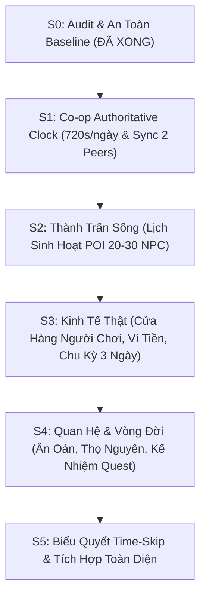

# KẾ HOẠCH TRIỂN KHAI BẢN MỞ RỘNG CO-OP
## CO-OP EXPANSION PLAN — ĐẠO TÀN: VẠN KIẾP
*Căn cứ tài liệu:* `docs/10_COOP_SOCIAL_ECONOMY_DYNASTY.md`  
*Thời điểm lập kế hoạch:* 04/11/2026  
*Quy chuẩn bắt buộc:* 1 ngày in-game = 12 phút thực (720s), Host-Authoritative, Co-op 2–4 người.

---

## 1. SƠ ĐỒ PHỤ THUỘC GIỮA CÁC SPRINT (DEPENDENCY GRAPH)

---

## 2. CHI TIẾT CÁC SPRINT VÀ TIÊU CHÍ NGHIỆM THU (DEFINITION OF DONE)

### SPRINT S0: AUDIT & BẢO VỆ DỰ ÁN (HOÀN THÀNH)
* **Nội dung:** Sao lưu toàn bộ dự án sang `DAO_TAN_VAN_KIEP_BACKUP_PHASE2`, lập báo cáo kiểm kê [COOP_EXPANSION_AUDIT.md](file:///g:/Game%20t%E1%BB%B1%20l%C3%A0m/DAO_TAN_VAN_KIEP_ANTIGRAVITY_BLUEPRINT/docs/COOP_EXPANSION_AUDIT.md).
* **Kết quả:** Kiểm tra 56/56 bài test đang có đều đạt 100%.

---

### SPRINT S1: CO-OP AUTHORITATIVE CLOCK & ĐỒNG BỘ 2 CLIENT (TRIỂN KHAI NGAY)
* **Mục tiêu:**
  1. Xây dựng module mạng tối thiểu `scripts/network/session_authority.gd` sử dụng `ENetMultiplayerPeer` (Host-Authoritative).
  2. Xây dựng module đồng bộ `scripts/network/clock_replication.gd` truyền dữ liệu thời gian (`world_day_index`, `second_in_day`, `time_scale`) từ Server sang Client.
  3. Đảm bảo tỷ lệ chuẩn: 1 giờ in-game = 30s thực, 1 ngày = 720s thực, độ lệch Client < 2 phút game.
  4. Mở menu cá nhân ở Client không làm đứng đồng hồ của Server.
  5. Viết unit test tự động `tests/unit/test_coop_clock_sync.gd` chứng minh 2 client có cùng ngày giờ authoritative.
* **Điều Cấm Kỵ Trong S1:**
  - Không cho phép Client tự ý đổi giờ.
  - Khóa hoàn toàn chức năng time-skip (chờ S5).
  - Không động vào hệ thống combat, breakthrough, quest cũ.

---

### SPRINT S2: THÀNH TRẤN SỐNG & LỊCH SINH HOẠT POI (KẾ HOẠCH TIẾP THEO)
* **Mục tiêu:**
  - Thiết lập lịch biểu hoạt động theo giờ cho 20–30 NPC tại thị trấn Thanh Trì (Giờ Mão họp chợ, Giờ Ngọ ăn trưa/nghỉ ngơi, Giờ Tuất đóng cửa về nhà).
  - Phân cấp mô phỏng NEAR (có hoạt ảnh tại thị trấn) và REGION/FAR (mô phỏng dữ liệu nền, không tạo node).
* **Điều Cấm Kỵ:** Không chạy pathfinding vật lý cho NPC ở ngoài tầm nhìn màn hình.

---

### SPRINT S3: KINH TẾ THẬT, VÍ TIỀN & CỬA HÀNG NGƯỜI CHƠI (KẾ HOẠCH TIẾP THEO)
* **Mục tiêu:**
  - Cho phép người chơi thuê 1 cửa hiệu tại chợ Thanh Trì Trấn.
  - Quản lý kho hàng vật lý, ví tiền riêng của shop, tuyển 1 NPC quản lý.
  - Chu kỳ kết toán 3 ngày: bổ sung sản lượng ngành nghề, trừ lương nhân công.
  - Giao dịch nguyên tử (Atomic): 2 người chơi cùng tranh mua 1 món hàng cuối cùng thì chỉ duy nhất 1 người thành công, người còn lại không bị trừ tiền.
* **Điều Cấm Kỵ:** Tuyệt đối không tạo tiền/vật phẩm ảo từ UI; không cho phép mua bán lặp vô hạn sinh lời.

---

### SPRINT S4: QUAN HỆ ĐA TẦNG, THỌ NGUYÊN & KẾ NHIỆM (KẾ HOẠCH TIẾP THEO)
* **Mục tiêu:**
  - Mở rộng đồ thị quan hệ: Cứu mạng tạo ân tình (`debt`), đả thương tạo cừu thù (`grudge`).
  - Xử lý kế nhiệm an toàn khi NPC nhiệm vụ hết thọ mạng tọa hóa (không làm treo quest).
* **Điều Cấm Kỵ:** Không áp dụng chết vĩnh viễn vì tuổi già cho nhân vật người chơi trong MVP.

---

### SPRINT S5: TIME-SKIP ĐỒNG THUẬN & HOÀN THIỆN TÍCH HỢP (KẾ HOẠCH CUỐI)
* **Mục tiêu:**
  - Cơ chế biểu quyết tua nhanh thời gian (1, 3, 7, 30 ngày): Đòi hỏi 100% người chơi đang kết nối cùng đồng ý và không ai đang chiến đấu.
  - Chạy mô phỏng batch tháng/năm có tính tất định (Deterministic).

---

## 3. MỆNH LỆNH DỪNG VÀ BÀN GIAO GIAI ĐOẠN

> **QUY TẮC BẮT BUỘC:**  
> Sau khi hoàn thành kiểm thử và chạy nghiệm thu **Sprint S1**, hệ thống sẽ dừng lại xuất báo cáo đầy đủ và đợi người dùng phê duyệt trước khi bắt đầu Sprint S2!
