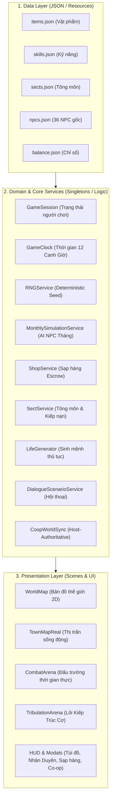

# ĐẠO TÀN: VẠN KIẾP (DAO TAN: VAN KIEP)
## TÀI LIỆU TỔNG QUAN THIẾT KẾ & KIẾN TRÚC GAME (GAME DESIGN & ARCHITECTURE DOCUMENT)

**Phiên bản tài liệu:** v1.0 — Chuẩn hóa sau kiểm toán độc lập V3  
**Thể loại:** 2D Top-down Open-World Sandbox Tu Tiên RPG (Nhập Vai Tiên Hiệp Hộp Cát Thế Giới Mở)  
**Nền tảng:** Windows PC (Offline Solo & Co-op Mạng Nội Bộ / LAN / Internet qua ENet)  
**Công nghệ:** Godot Engine v4.7.2 (GDScript), Thiết kế dựa trên dữ liệu (Data-Driven JSON)  
**Định hướng trải nghiệm:** Tự do xây dựng vận mệnh, thế giới sống tự vận hành, không ép cốt truyện tuyến tính.

---

## I. TỔNG QUAN TẦM NHÌN (GAME VISION)

### 1. Ý tưởng cốt lõi (Elevator Pitch)
**ĐẠO TÀN: VẠN KIẾP** đưa người chơi vào một thế giới tu chân tàn khốc, lấy cảm hứng từ chiều sâu hộp cát của *Quỷ Cốc Bát Hoang (Tale of Immortal)* và không khí tu đạo cầu sinh khắc nghiệt của *Tiên Nghịch*.

Người chơi xuất thân từ một phàm nhân vô danh tại vùng biên trấn hẻo lánh Thanh Trì. Bạn có thể bái nhập đại tông môn trở thành chính đạo kiếm tu, có thể làm tán tu mở sạp buôn bán thao túng thị trường đan dược, ngao du bí cảnh săn lùng cổ bảo, hoặc sa vào ma đạo kết thù với cả thiên hạ. 

**Điểm đặc biệt nhất:** Dù bạn có can thiệp hay không, thế giới tu tiên vẫn tự động xoay vần: hàng trăm NPC có tuổi thọ, khát vọng, tự kết ân oán, tự đột phá hoặc thọ tận chết đi theo từng tháng.

### 2. Bốn Trụ Cột Trải Nghiệm (4 Core Pillars)
1. **Tu Tiên Có Cái Giá:** Cảnh giới gắn liền với tuổi thọ, tài nguyên khan hiếm, độ khó đột phá và Thiên Kiếp Lôi Đình sinh tử.
2. **Thế Giới Biết Nhớ (Living World):** NPC ghi nhớ mọi hành vi của người chơi; có hệ thống ân oán đa chiều (*Ân tình, Nợ nần, Thù hận, Kính sợ*); môn phái có thể hưng thịnh hay lụi tàn.
3. **Tự Do Xây Dựng Vận Mệnh (Emergent Sandbox):** Không có nhiệm vụ chính tuyến bắt buộc sau giai đoạn mở đầu. Lựa chọn hội thoại 3–5 nhánh âm thầm làm biến đổi thế giới.
4. **Co-op Đồng Hành Chân Thực:** Cùng bạn bè (2–4 người) lập phòng cùng đi chung bản đồ, cùng săn Boss bí cảnh, trao đổi giao thương qua sạp hàng chợ Tán Tu với hệ thống chống gian lận/nhân bản đồ tuyệt đối.

---

## II. KIẾN TRÚC KỸ THUẬT HỆ THỐNG (TECHNICAL ARCHITECTURE)

Dự án áp dụng mô hình kiến trúc tách lớp hiện đại **Domain-Driven Design (DDD)** trên nền tảng Godot 4.7.2:

### Các Autoload Cốt Lõi:
- **`GameClock`:** Quản lý dòng chảy thời gian. **1 ngày in-game = 12 phút thực tế (720 giây)**. 1 ngày = 12 Canh Giờ, 30 ngày = 1 tháng, 12 tháng = 1 năm (360 ngày). Có cơ chế Tĩnh Tọa gia tốc x20 trong chế độ chơi đơn; khóa cứng 1.0x khi chơi mạng Co-op.
- **`GameSession`:** Quản lý dữ liệu người chơi cục bộ: HP/MP, tấn công, phòng ngự, cảnh giới, túi đồ (Inventory), danh sách boss đã hạ, quan hệ NPC và ký ức thế giới.
- **`ContentRegistry`:** Kho từ điển nạp và kiểm tra dữ liệu JSON khi game khởi động.
- **`SaveService`:** Cơ chế lưu trữ nguyên tử (Atomic Write `.tmp` $\rightarrow$ `.json`), kiểm soát Schema Version, tự động sao lưu file `.bak.json` và phục hồi chống mất dữ liệu khi mất điện/crash.
- **`MonthlySimulationService`:** Bộ máy mô phỏng thế giới hàng tháng. Sử dụng thuật toán băm xác định `hash_combine(world_seed, year, month, npc_id)`. Đã kiểm định chịu tải **1,000 NPC** chỉ trong **~95 ms**.
- **`CoopWorldSync` & `SessionAuthority`:** Kiến trúc mạng ENet Host-Authoritative. Máy chủ Host có thẩm quyền tuyệt đối về thời gian, máu quái, vật phẩm, số dư ví và kho sạp hàng.

---

## III. CÁC HỆ THỐNG CƠ CHẾ GAMEPLAY CỐT LÕI (CORE GAME MECHANICS)

### 1. Hệ Thống Tu Luyện, Cảnh Giới & Thiên Kiếp
- **Thang Cảnh Giới (10 Bậc Khởi Đầu):**
  - *Phàm Nhân* $\rightarrow$ *Luyện Khí Tầng 1* đến *Tầng 9* $\rightarrow$ *Trúc Cơ Sơ Kỳ*.
  - Mỗi tầng cảnh giới gia tăng đáng kể các thuộc tính cơ bản: Khí huyết (HP), Linh lực (MP), Công lực (Atk), Thân pháp (Speed) và Thọ nguyên (Lifespan).
- **Quy Luật Đột Phá Luyện Khí:**
  - Tích lũy đủ Tu Vi (XP) qua chiến đấu, tĩnh tọa hoặc dùng đan dược.
  - Sử dụng đan dược hỗ trợ (*Tụ Khí Đan, Phá Cảnh Đan*) để xung phá kinh mạch.
- **Thiên Kiếp Lôi Đình Trúc Cơ (Tribulation Arena):**
  - Đột phá từ Luyện Khí Tầng 9 lên Trúc Cơ là bước ngoặt cải tử hoàn sinh.
  - Người chơi phải tiêu hao **1x Tẩy Tủy Đan** và bước vào bí cảnh Lôi Kiếp.
  - Phải sống sót qua **9 đợt sấm sét thiên kiếp** giáng xuống với sát thương diện rộng và bán kính ngày càng khủng khiếp. Đòi hỏi kỹ năng khinh công lướt né (Dash i-frame) và các công pháp hộ thể.
- **Tuổi Thọ & Lão Hóa (Lifespan & Permadeath):**
  - Tuổi thọ không phải con số vô nghĩa: Luyện Khí sống tối đa 120 năm, Trúc Cơ sống 250 năm.
  - Thời gian trôi qua mỗi năm làm nhân vật già đi. Nếu không kịp đột phá trước khi hết thọ nguyên, nhân vật sẽ tọa hóa (chết già).

---

### 2. Hệ Thống Chiến Đấu Thời Gian Thực (Top-Down Real-Time Action)
- **Góc nhìn & Thao Tác:** 
  - Góc nhìn 2.5D từ trên xuống (Top-down). Di chuyển linh hoạt đa lớp (WASD, phím mũi tên, Click chuột di chuyển).
- **Khinh Công Lướt Gió (Qinggong Dash):**
  - Nhấn phím **Space** để kích hoạt khinh công (Tốc độ lướt **780 px/s**, thời gian lướt 0.22s, thời gian hồi 0.9s).
  - Có khung bất tử ngắn (i-frame) giúp né tránh đòn đánh diện rộng của quái vật và tia sét thiên kiếp.
- **Hệ Thống Kỹ Năng & Pháp Thuật Đa Hệ:**
  - *Đòn đánh thường (Trảm Kiếm):* Chém kiếm cận chiến, có tỷ lệ bạo kích (Crit) gây 150% sát thương.
  - *Kiếm Khí Sơ Khởi (Kim hệ):* Bắn ra luồng kiếm khí xuyên thấu tầm xa.
  - *Lôi Quang Phá (Lôi hệ):* Sấm sét giáng xuống điểm chỉ định, gây choáng diện rộng (Stun 1.0s).
  - *Thanh Mộc Trói (Mộc hệ):* Rễ cây trồi lên trói chân kẻ địch (Root 2.5s).
- **Hệ Thống Boss AI & Telegraph Cảnh Báo:**
  - Boss sở hữu thanh máu độc lập, các pha cuồng bạo (Enrage Phase khi máu dưới 40%).
  - Hệ thống cảnh báo Telegraph trực quan: Vòng tròn đỏ, cung quét kiếm khí giúp người chơi phán đoán và phản xạ né tránh.
  - Sát thương bay (Floating Combat Text) phân biệt rõ đòn thường (trắng) và Bạo Kích (vàng kim rực rỡ).

---

### 3. Thế Giới Tự Vận Hành & Trí Tuệ Nhân Tạo NPC (Living World & Social Graph)
- **Đội Ngũ NPC Đa Tầng:**
  - **36 NPC Cốt Truyện Cố Định:** Có tiểu sử, tính cách, nhà cửa và nhiệm vụ riêng.
  - **Hàng trăm NPC Thủ Tục (`LifeGenerator`):** Tự sinh họ tên Hán-Việt, khát vọng sống (*Báo thù, Cứu người thân, Cầu trường sinh...*), dị tật bẩm sinh và bí mật đời tư.
- **Mô Phỏng Hàng Tháng (Monthly World Simulation):**
  - Mỗi khi hết 30 ngày, hệ thống chạy mô phỏng nền cho toàn bộ NPC trong thế giới bằng Utility AI với 7 nhánh ý định:
    1. *Tu luyện (Train):* Tăng tu vi, có thể đột phá thăng cấp.
    2. *Giao thương (Trade):* Mua bán đan dược, vũ khí, khoáng thạch.
    3. *Nhiệm vụ (Quest):* Đi săn yêu thú, hái thuốc.
    4. *Du ngoạn (Travel):* Di chuyển giữa các vùng bản đồ.
    5. *Xã giao (Relationship):* Kết bạn, cầu thân hoặc kết thù.
    6. *Tranh đấu (Fight):* Tỷ thí cướp bảo vật, có thể bị thương tật hoặc tử vong.
    7. *Nghỉ ngơi (Rest):* Dưỡng thương, tiêu thụ linh dược.
- **Đồ Thị Quan Hệ Xã Hội Đa Chiều (Social Graph):**
  - Không phân biệt tốt/xấu đơn thuần. Mối quan hệ giữa người chơi và NPC đo lường qua:
    - *Thiện cảm (Affinity)*
    - *Tin cậy (Trust)*
    - *Kính sợ (Fear)*
    - *Ân nợ (Debt)*
    - *Thù hận (Grudge)*
- **Sổ Đại Sự Ký (Gazette - Phím L):**
  - Ghi chép toàn bộ biến động lịch sử của tu chân giới theo từng tháng: Tu sĩ nào vừa tử nạn ở rừng trúc, ai vừa đột phá cảnh giới, môn phái nào vừa tích lũy thêm đại lượng ngân khố.

---

### 4. Hội Thoại Phân Nhánh Bí Mật & Kiến Tạo Thế Giới (World Shaping Dialogue)
- **Hội Thoại 3–5 Lựa Chọn Triết Lý:**
  - Người chơi khi đối thoại trong các tình huống nan giải được quyền chọn từ 3 đến 5 câu trả lời đại diện cho các phong cách tu đạo:
    1. *Chính Đạo Kiếm Tu:* Trực diện, trảm yêu trừ ma, trọng danh dự.
    2. *Ma Đạo Lợi Kỷ:* Thực dụng, tàn nhẫn, đoạt lợi ích tối đa.
    3. *Thương Lộ Thao Túng:* Dĩ hòa vi quý, dùng tiền tài và trao đổi để mở đường.
    4. *Đạo Duyên Huyền Ảo:* Thuận theo tự nhiên, tìm kiếm nhân quả kỳ ngộ.
    5. *Bình Thản Ẩn Danh:* Tránh né thị phi, giữ mình an toàn.
- **Bí Mật & Bất Ngờ (Không Hiển Thị Số Liệu Trước):**
  - Giao diện **hoàn toàn không hiển thị** "+10 thiện cảm" hay "-50 vàng" trước khi bấm chọn.
  - Người chơi phải tự phán đoán dựa trên tính cách đối phương. Mỗi lựa chọn âm thầm tạo nên các hiệu ứng bướm:
    - Làm biến động giá cả thị trường thuốc men, vũ khí (`market_modifiers`).
    - Làm NPC ghi nhớ vào bộ ký ức (`memories`) để trả ơn hoặc thuê sát thủ báo thù sau này.
    - Kích hoạt các kỳ ngộ bí cảnh ẩn.

---

### 5. Kinh Tế Sạp Hàng Tu Sĩ & Thị Trường Chợ Tán Tu (Decentralized Stall Escrow)
- **Thuê Sạp Hàng Người Chơi:**
  - Người chơi đến Chợ Tán Tu tại Thanh Trì Trấn, tiêu hao 50 Linh Thạch để thuê một gian sạp hàng trong 3 ngày.
- **Ký Gửi Kho Hàng (Escrow System):**
  - Đặt đan dược, khoáng thạch, pháp bảo vào sạp, tự do định giá bán.
  - Hàng hóa được ký gửi an toàn vào kho trung gian. Người chơi có thể tự do đi phiêu lưu, săn quái.
- **Giao Dịch Tự Động & Quyết Toán:**
  - NPC trong trấn theo lịch trình đi chợ sẽ ghé qua sạp và mua hàng nếu giá cả hợp lý.
  - Doanh thu Linh Thạch tích lũy tự động, người chơi có thể ghé về sạp để rút tiền và rút hàng tồn kho bất kỳ lúc nào.
- **Kinh Tế Mạng Co-op Chống Gian Lận (Authoritative Anti-Duping):**
  - Toàn bộ ví tiền và kho hàng được máy chủ Host xác thực.
  - Ngăn chặn 100% tình trạng hack tiền ảo, spam gói tin (Idempotent 3x retry an toàn), và xử lý chuẩn xác khi 2 người chơi cùng tranh mua món hàng duy nhất còn lại trong sạp.

---

### 6. Môn Phái, Nghề Nghiệp & Tương Tác Thị Trấn
- **Hệ Thống Tông Môn:**
  - *Thanh Vi Kiếm Tông:* Môn phái kiếm tu thượng thừa, trọng kiếm đạo và lôi kiếp.
  - *Bách Thảo Môn:* Môn phái đan tu, tập trung trồng trọt linh thảo và luyện đan.
  - *Tán Tu Liên Minh:* Giới tu sĩ tự do tại Chợ Tán Tu.
  - Người chơi tích lũy điểm Cống Hiến Môn Phái để thăng tiến cấp bậc (*Tạp dịch $\rightarrow$ Ngoại môn $\rightarrow$ Nội môn $\rightarrow$ Chân truyền $\rightarrow$ Trưởng lão*).
- **Tàng Kinh Các (Library Skills Learning):**
  - Dùng điểm cống hiến để mở khóa các công pháp bí truyền: Tăng tầm xuất chiêu, tăng tốc độ khinh công, đặc biệt là bí quyết tăng kháng tính trước Thiên Kiếp Lôi Đình.
- **Nghề Luyện Đan (Alchemy Crafting):**
  - Tương tác với lò đan tại Dược Phẩm Các.
  - Chọn dược liệu theo công thức (*Linh thảo, Xà cốt, Mộc tinh...*), điều chỉnh hỏa hầu.
  - Chế tạo các loại đan dược phẩm cấp khác nhau: *Hồi Xuân Đan* (hồi máu), *Tụ Khí Đan* (tăng tu vi), *Tẩy Tủy Đan* (bảo vật vượt lôi kiếp).
- **Đồ Vật Thế Giới Tương Tác (Smart Objects):**
  - *Giếng Nước Cổ:* Múc nước uống hồi phục 30 HP.
  - *Bàn Trà Quán Cóc:* Uống trà đàm đạo, tịnh tâm đẩy lùi mệt mỏi và thúc đẩy thời gian 1 canh giờ.

---

### 7. Bản Đồ Hộp Cát Sandbox & 4 Vùng Đất Khám Phá (Biomes)
1. **Thanh Trì Trấn (Living Town):**
   - Vùng an toàn ban đầu với quán trọ, lò đan, sạp hàng, phân điện tông môn, hệ thống đèn lồng tự thắp sáng khi đêm xuống (Giờ Tuất đến Giờ Dần).
2. **Rừng Trúc U Tịch (Bamboo Forest Biome):**
   - Nơi thu hái Mộc Linh Thảo, khám phá Thạch Động bí cảnh chứa rương cổ xưa.
3. **Đầm Lầy Hắc Xà (Snake Swamp Biome):**
   - Vùng sương độc nguy hiểm, nơi sinh sống của loài độc xà và tế đàn cổ xưa để hiến tế dược liệu cầu phúc.
4. **Cổ Kiếm Trũng (Sword Grave Biome):**
   - Vùng phế tích ngập tràn kiếm gãy của các bậc tiền bối. Có Tàn Kiếm Bia để đốn ngộ (+50 Tu Vi) và Kiếm Đài cắm Cổ Kiếm Tàn Phiến.

---

### 8. Chế Độ Chơi Mạng Đồng Đội Co-op (2–4 Người Chơi)
- **Mô hình Host-Client Tiện Lợi:** Một người chơi mở phòng làm Host (chọn port, mặc định 8899), bạn bè nhập IP/Port để tham gia trực tiếp trong game (bấm phím `[O]` trên HUD).
- **Đồng Bộ Avatar & Di Chuyển:** Mọi người chơi nhìn thấy avatar của nhau, hiển thị tên và hướng nhìn, chuyển động bước đi và hoạt ảnh khinh công mượt mà.
- **Hợp Lực Đánh Boss:** Cùng bước vào Đấu Trường Bí Cảnh đánh Boss. Máy chủ Host xác minh khoảng cách, thời gian hồi chiêu và tính toán sát thương, phân chia chiến lợi phẩm công bằng cho cả phòng.
- **Khóa Thời Gian Tuyệt Đối:** Trong phiên co-op, nhịp thời gian cưỡng chế cố định 1.0x (1 ngày = 720 giây thực), loại bỏ hoàn toàn tình trạng một người tua nhanh làm desync thế giới của người khác.

---

## IV. BẢNG TỔNG KẾT ĐÁNH GIÁ CHẤT LƯỢNG KỸ THUẬT

| Hạng mục kiểm tra | Chỉ số thực tế | Đánh giá | Ghi chú kỹ thuật |
|---|:---:|:---:|---|
| **Bộ kiểm thử tự động (Unit Tests)** | **179 / 179 PASS** | **100% ĐẠT** | 24 Test Suites bao phủ toàn bộ Logic, Clock, Save, Co-op, Combat |
| **Kiểm thử mạng 2 tiến trình** | **10 / 10 Bước PASS** | **100% ĐẠT** | Test ENet độc lập: Đồng bộ di chuyển, Boss, Loot, Snapshot, Reconnect |
| **Kiểm thử tranh mua 3 cửa sổ** | **3 / 3 Tiến trình PASS** | **100% ĐẠT** | 1 Host + 2 Clients cùng mua món cuối: Không âm kho, không duping |
| **Tốc độ mô phỏng ngầm 1,000 NPC** | **~95 ms / tháng** | **XUẤT SẮC** | Hoàn toàn không gây giật lag hoặc tụt FPS khi chơi game |
| **Cơ chế lưu trữ (Save/Load)** | **Atomic Write v2** | **AN TOÀN** | Chống hỏng file, tự động khôi phục từ bản sao `.bak.json` |
| **Mỹ thuật & Đồ họa (Phase 4)** | **Pixel Prototype** | **PARTIAL** | Bộ khung code và render hoàn tất; sẵn sàng thay thế spritesheet từ artist |

---

## V. TỔNG KẾT

**ĐẠO TÀN: VẠN KIẾP** không xây dựng một câu chuyện định sẵn mà bạn buộc phải đọc từ đầu đến cuối; game tạo ra một **vũ trụ tu tiên chân thực có linh hồn**. Bạn được tự do chọn đạo tâm của mình, tự đối mặt với thiên kiếp lôi đình, tự mở sạp buôn bán, tự kết giao bằng hữu và cùng bạn bè viết nên huyền thoại tu tiên của riêng mình.
